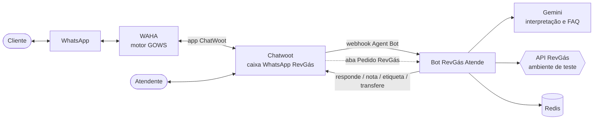

# 🔥 RevGás Atende

**Atendente virtual de pedidos de gás no WhatsApp, com central de atendimento humano (Chatwoot) e venda registrada direto no ERP RevGás.**

Projeto de Extensão VI · Transformação Digital · 2026.2


## O que faz

- 🛒 **Pedido completo na conversa:** nome, produto, quantidade, endereço e pagamento (com troco). Aceita menus numerados **ou** texto livre: *"manda 2 botijão pra Rua Nova 10, Centro, Teresina PI, pago no pix"*.
- ✅ **Só vende com confirmação:** mostra o resumo com o preço do catálogo e cria a venda (`POST /v1/sales`) só depois do "1 - Confirmar". Nunca duplica.
- 🙋 **Humano de verdade:** "quero falar com um atendente", dúvida que o bot não entende ou falha na API → a conversa vai para a fila do Chatwoot com uma **nota-resumo** e **etiquetas**.
- 🚨 **Vazamento de gás:** orientações de segurança na hora e conversa marcada como **urgente** no painel.
- 🧠 **A IA só entende, quem decide é o código:** preço, produto e criação da venda nunca dependem da IA. Sem IA, tudo funciona pelos menus.

## Arquitetura



A ponte WhatsApp ↔ Chatwoot é o **[WAHA](https://waha.devlike.pro/)** (Core, grátis e sem licença), que substituiu a Evolution API em 21/11/2026. Os motivos e as evidências estão em [docs/decisoes/2026-11-21-troca-evolution-waha.md](docs/decisoes/2026-11-21-troca-evolution-waha.md). O bot só fala com o Chatwoot, então a troca não mexeu nele. Ele atende só conversas no **privado** e ignora grupos do WhatsApp.

| Pasta | O que tem |
|---|---|
| `src/canal/` | Webhook e cliente da API do Chatwoot; ligação WAHA ↔ Chatwoot do setup (`whatsapp.ts`) |
| `src/conhecimento/` | FAQ com RAG (dúvidas dos clientes) |
| `src/conversa/` | Motor da conversa (máquina de estados), textos, emergência, sessões |
| `src/ia/` | Interpretação de texto livre (Gemini) e validação da resposta |
| `src/vendas/` | Catálogo, pedido, porta da API RevGás (falsa e real) |
| `config/` | Catálogo de produtos, orientações de segurança e FAQ (`config/faq/`, base do RAG) |
| `scripts/setup.ts` | Liga WAHA ↔ Chatwoot ↔ bot |
| `scripts/chatwoot-config.ts` | Etiquetas, respostas prontas, atributos, horário e aba "Pedido RevGás" (definições em `src/canal/painel.ts`) |
| `scripts/chatwoot-ajustes.rb` | Marca RevGás, menu "Pedidos de hoje" e cache do painel (dentro do Chatwoot) |
| `src/painel/` | Aba "Pedido RevGás" na conversa e lista "Pedidos de hoje" no menu: venda no ERP e cancelamento de venda de teste |
| `docs/` | Design e plano (`superpowers/`), registro de decisões (`decisoes/`), estudo de avaliação da IA (`relatorio/avaliacao-ia/`) e dados de demonstração |

Detalhes e decisões: [documento de design](docs/superpowers/specs/2026-11-18-revgas-atende-design.md).

**Avaliação da IA:** intenção 100%, extração F1 97,2% e −45% de mensagens com IA (Wilcoxon p < 0,001). Estudo completo em [docs/relatorio/avaliacao-ia](docs/relatorio/avaliacao-ia/README.md).

## Como rodar

### Só os testes (sem Docker)

```bash
npm install
npm test
```

### Tudo, com WhatsApp

Precisa de **Docker Desktop** (≈ 4 GB de RAM livres) e de um **chip separado** (o WAHA não é a API oficial do WhatsApp; o número pode ser bloqueado). **Não use número pessoal:** com o bot ligado, qualquer pessoa que escrever para o número recebe a resposta do bot.

1. `cp .env.example .env` e preencha `POSTGRES_PASSWORD`, `SECRET_KEY_BASE`, `WAHA_API_KEY`, `WAHA_DASHBOARD_PASSWORD`, `BOT_WEBHOOK_TOKEN` e `PAINEL_TOKEN` com valores aleatórios (os tokens com 32+ caracteres).
2. `docker compose pull --ignore-buildable` e depois `docker compose up -d` (a primeira vez demora: baixa as imagens e prepara o banco). Se o download falhar ou parar sem erro, rode o `pull` de novo antes do `up`.
   - Até o passo 5, o `bot` fica reiniciando com `CHATWOOT_BOT_TOKEN: Too small` nos logs. É esperado: o token só existe depois do setup.
3. Abra **http://localhost:3000**, crie a conta de administrador e copie o token de acesso do seu perfil para `CHATWOOT_ADMIN_TOKEN`. Confira também o número da conta no endereço do painel (`/app/accounts/<número>/...`) e coloque-o em `CHATWOOT_ACCOUNT_ID`: numa instalação nova, ele pode não ser `1`.
4. `npm install` e `npm run setup`: ele cria o Agent Bot, a caixa de entrada "WhatsApp RevGás", a integração do WAHA com o Chatwoot e a sessão do WhatsApp. Pode rodar de novo sem duplicar nada; numa instalação que vinha da Evolution, veja abaixo.
5. Coloque o `CHATWOOT_BOT_TOKEN` que o setup mostrou no `.env` e rode `docker compose up -d --build`. A partir daqui, **todo `docker compose up` configura o painel sozinho** (veja abaixo).
6. Abra **http://127.0.0.1:3002/dashboard** (usuário e senha do `.env`). Na primeira vez, cole a `WAHA_API_KEY` no "Worker" (ícone de lápis) para ele enxergar as sessões. Na sessão `default`, leia o QR code com o celular do chip (WhatsApp → Aparelhos conectados). O QR expira em ~1 min; se a sessão ficar `FAILED`, clique em *Restart* na linha da sessão `default` (tabela *Sessions*, não a de *Workers*).
   - Na primeira vez, é comum a sessão já estar `FAILED` quando você chega ao dashboard: o `npm run setup` liga a sessão na hora, e os QR expiram enquanto você faz o login e cola a chave no Worker.
   - Evite conectar e desconectar o número várias vezes seguidas: o WhatsApp passa a recusar novos aparelhos por um tempo ("não é possível conectar novos dispositivos no momento").
   - **Um computador por vez no chip.** Se dois computadores estiverem conectados ao mesmo número, os dois bots respondem ao cliente. No celular do chip, em *Aparelhos conectados*, deve aparecer só o seu.
7. Mande "oi" para o número do chip, de outro celular. 🎉 No Chatwoot, as conversas atendidas pelo bot ficam como **pendentes**: troque o filtro da lista de "Abertas" para "Pendentes" ou "Todas" para vê-las.

### Quem já rodava com a Evolution

> Guia completo de atualização (também para o assistente de IA de cada integrante): [docs/atualizar-ambiente.md](docs/atualizar-ambiente.md).

1. Coloque `WAHA_API_KEY` e `WAHA_DASHBOARD_PASSWORD` no `.env`, com valores aleatórios (sem elas, o `docker compose` não sobe).
2. `docker compose up -d --remove-orphans`: sobe o WAHA e remove o container da Evolution, que senão continuaria ligado ao número.
3. `npm run setup`: reaproveita a caixa "WhatsApp RevGás" e só troca o endereço dela para o WAHA. As conversas antigas ficam; o WAHA acha os contatos que já existem pelo telefone ou pelo identificador do WhatsApp.
4. Leia o QR code como no passo 6 acima. O banco `evolution` no Postgres e o volume `evolution_instances` ficam sem uso; apague-os quando quiser.

### Painel configurado automaticamente

A cada `docker compose up`, dois serviços rodam uma vez e terminam (podem rodar de novo sem duplicar nada):

- **`chatwoot-config`** (`scripts/chatwoot-config.ts`, pela API do Chatwoot): etiquetas com cor, respostas prontas (`/saiu`, `/endereco`, `/seguranca`, `/horario`, `/obrigado`), dados do pedido na lateral da conversa, horário de atendimento da caixa e a aba **Pedido RevGás** em cada conversa (o pedido, a venda no ERP e "Cancelar venda de teste").
- **`chatwoot-ajustes`** (`scripts/chatwoot-ajustes.rb`, dentro do Chatwoot): marca RevGás (logo, ícone, nome e cores laranja), item **Pedidos de hoje** no menu lateral (abre por cima do Chatwoot a lista de todos os pedidos do dia) e renovação do cache do painel.

Antes da primeira instalação (sem `CHATWOOT_ADMIN_TOKEN` ou sem o `npm run setup`), o `chatwoot-config` só avisa no log e não trava nada. A aba e o menu só aparecem com `PAINEL_TOKEN` (32+ caracteres) e apontam para o painel em `http://127.0.0.1:3001`; se publicar o painel em outro endereço, defina `PAINEL_URL`. As páginas do painel só funcionam dentro do Chatwoot, a porta dele só existe em `127.0.0.1` e a API exige o token. Para rodar à mão: `docker compose run --rm chatwoot-config` e `docker compose run --rm chatwoot-ajustes` (ou `npm run chatwoot:config`, de fora do Docker).

### Marca RevGás no painel

O Chatwoot é open source (MIT), e a marca personaliza o painel **sem fork e sem tocar no código pago (Enterprise)**:

- **Logo, ícone e nome:** grava as configurações do núcleo do Chatwoot (`scripts/aplicar-marca.rb`, aplicado sozinho pelo serviço `chatwoot-ajustes`). Os arquivos ficam em `marca/` e são servidos pelo próprio Chatwoot em `/marca/`.
- **Cores:** `scripts/marca.ts` lê o CSS compilado do Chatwoot e gera `marca/tema.css`, trocando a escala azul da marca pelo laranja RevGás (#FC692B), nos modos claro e escuro. O arquivo gerado fica no repositório.

Ao atualizar a versão do Chatwoot, rode `npm run marca` para gerar o `marca/tema.css` de novo e faça commit dele.

### Painel de análise (Metabase)

O painel **"Integração RevGás"** mostra ao vivo as requisições do bot à API RevGás (rota, status e tempo), a taxa de sucesso, as vendas por hora, os cancelamentos, os clientes reconhecidos e as transferências para atendente. Ele lê só as tabelas do banco `revgas` no Postgres, com o usuário `metabase_leitura`, sem acesso aos dados do Chatwoot, e essas tabelas não guardam nome, telefone, endereço nem texto de mensagem.

1. `docker compose up -d metabase` (na primeira vez, leva de 1 a 2 minutos para iniciar).
2. Abra **http://127.0.0.1:3003**. Quem sobe o Metabase no próprio computador cria a conta de administrador; ela fica só nesse computador.
3. Crie uma chave de API no Metabase (Admin → Configurações → Autenticação → Chaves de API, grupo Administradores), coloque-a em `METABASE_API_KEY` no `.env` e rode `npm run metabase:painel`: ele conecta ao banco `revgas` com o usuário `metabase_leitura` e monta o painel com as consultas de [docs/metabase.md](docs/metabase.md), que também traz o passo a passo manual e o SQL de cada gráfico.

O Metabase usa cerca de 1,4 GB de memória, mesmo com o Java limitado a 768 MB. Em computadores com pouca RAM para o Docker, suba-o só quando for usar e pare com `docker compose stop metabase`.

**IA:** coloque `GEMINI_API_KEY` (cota grátis do [Google AI Studio](https://aistudio.google.com/)) e, em `NUMEROS_IA`, os números que usam a IA (separados por vírgula) ou `*` para todos, como no cenário da demo. Os números fora da lista são atendidos pelos menus, e os menus também são o caminho de reserva quando a IA demora ou falha. Na cota grátis o Google pode usar as mensagens: avise quem for testar.

**Segurança:** mantenha o bot apenas na rede interna do Docker, use um `BOT_WEBHOOK_TOKEN` aleatório com ao menos 32 caracteres e troque-o se ele aparecer em logs ou configurações expostas. O bot limita rajadas de mensagens e as métricas sem conteúdo de conversa expiram em 90 dias por padrão (`METRICAS_RETENCAO_DIAS`).

**Venda no ERP (API de teste da RevGás):** a RevGás liberou, em parceria com a faculdade, uma **API de teste** (`api.revgas.com`, estabelecimento de demonstração 2580), separada da produção. Com `VENDA_REAL=true`, `REVGAS_API_KEY`, `REVGAS_CLIENTE_DEMO=5700355` e `REVGAS_ESTABELECIMENTO=2580`, cada pedido confirmado cria a venda nesse ambiente, sem avisar entregadores. Para limpar depois de testar: `npm run cancelar-venda -- <id>`.

## Equipe

| | Responsável por |
|---|---|
| **Lucas Oliveira** | Base técnica, avaliação da IA e experimento com/sem IA |
| **Eduardo** | Base de conhecimento (RAG) para dúvidas frequentes |
| **João Vitor** | Venda real no ERP e deploy |
| **Luiza** | Teste com usuários (SUS), roteiro da demo e relatório |

As tarefas de cada um estão nas issues do GitHub. Veja [CONTRIBUTING.md](CONTRIBUTING.md).
