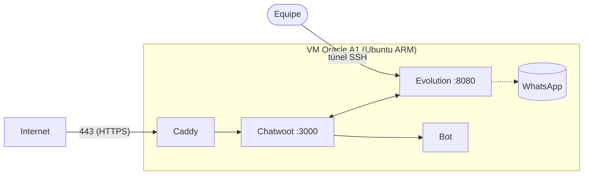

# Deploy na Oracle Cloud (Always Free)

Passo a passo para colocar o RevGás Atende no ar 24h numa máquina grátis da Oracle Cloud, com o painel do Chatwoot em **HTTPS**. Tempo estimado: 40–60 minutos na primeira vez.



**Só o painel do Chatwoot fica público.** A Evolution (QR code) e o bot continuam fechados: você acessa a Evolution por um túnel SSH.

---

## 1. Criar a máquina

No console da Oracle: **Compute → Instances → Create instance**.

| Campo | Valor |
|---|---|
| Image | **Canonical Ubuntu 24.04** (a versão *aarch64*, que a Oracle escolhe sozinha para Ampere) |
| Shape | **VM.Standard.A1.Flex**: 2 OCPU e 12 GB já sobram (o limite grátis é 4 OCPU / 24 GB no total) |
| Networking | VCN padrão, **sub-rede pública**, marcar *Assign a public IPv4 address* |
| SSH keys | *Generate a key pair*: **baixe a chave privada** (sem ela não dá para entrar) |
| Boot volume | 50 GB (padrão) é suficiente; o grátis vai até 200 GB |

Anote o **IP público** da instância.

> **"Out of host capacity"?** É falta de máquina ARM livre na região. Tente outro *Availability Domain* no mesmo formulário ou tente de novo mais tarde.

## 2. Liberar as portas na rede da Oracle

**Networking → Virtual Cloud Networks → (sua VCN) → Security Lists → Default Security List → Add Ingress Rules**:

| Source CIDR | Protocolo | Porta | Para quê |
|---|---|---|---|
| `0.0.0.0/0` | TCP | **80** | certificado HTTPS (Let's Encrypt) |
| `0.0.0.0/0` | TCP | **443** | painel do Chatwoot |

A porta 22 (SSH) já vem liberada. **Não abra 3000 nem 8080.**

## 3. Entrar na máquina

No seu computador (troque o caminho da chave e o IP):

```bash
chmod 600 ~/Downloads/ssh-key-oracle.key
ssh -i ~/Downloads/ssh-key-oracle.key ubuntu@IP_PUBLICO
```

No Windows, o mesmo comando funciona no PowerShell ou no Git Bash.

## 4. Abrir as portas no firewall da própria máquina

A imagem Ubuntu da Oracle **já vem com o iptables bloqueando tudo**, além da Security List. Este é o erro mais comum: sem este passo o site não abre, mesmo com o passo 2 feito.

```bash
sudo iptables -I INPUT 6 -m state --state NEW -p tcp --dport 80 -j ACCEPT
sudo iptables -I INPUT 6 -m state --state NEW -p tcp --dport 443 -j ACCEPT
sudo netfilter-persistent save
```

## 5. Instalar o Docker

```bash
curl -fsSL https://get.docker.com | sudo sh
sudo usermod -aG docker ubuntu
exit
```

O `exit` é para o grupo `docker` valer. Entre de novo com o `ssh` do passo 3 e confira:

```bash
docker run --rm hello-world
```

## 6. Domínio grátis (DuckDNS)

O HTTPS precisa de um nome de domínio.

1. Entre em https://www.duckdns.org com uma conta (GitHub ou Google).
2. Crie um subdomínio, por exemplo `revgas-atende`, e em **current ip** coloque o **IP público** da Oracle.
3. Confira na máquina (deve mostrar o IP público):
   ```bash
   getent hosts revgas-atende.duckdns.org
   ```

## 7. Baixar o projeto

O repositório é privado. O jeito mais simples é usar o GitHub CLI:

```bash
sudo apt-get install -y gh
gh auth login            # escolha GitHub.com → HTTPS → "Login with a web browser" e siga o código
gh repo clone lucazolvr/revgas-atende
cd revgas-atende
```

## 8. Configurar o `.env`

```bash
cp .env.example .env
nano .env
```

Preencha (gere cada segredo com `openssl rand -hex 32`):

| Variável | Valor |
|---|---|
| `POSTGRES_PASSWORD`, `SECRET_KEY_BASE`, `EVOLUTION_API_KEY`, `BOT_WEBHOOK_TOKEN` | um valor de `openssl rand -hex 32` cada |
| `DOMINIO` | `revgas-atende.duckdns.org` (sem `https://`) |
| `FRONTEND_URL` | `https://revgas-atende.duckdns.org` |
| `GEMINI_API_KEY`, `GEMINI_MODELO`, `NUMEROS_IA` | os mesmos do `.env` do notebook |
| `VENDA_REAL` | `false` até o cliente de demonstração ser confirmado (issue #3) |

Deixe `CHATWOOT_ADMIN_TOKEN` e `CHATWOOT_BOT_TOKEN` vazios por enquanto. No `nano`: `Ctrl+O`, `Enter` para salvar e `Ctrl+X` para sair.

> O `.env` tem todas as chaves: **nunca** faça commit dele nem cole o conteúdo em chat.

## 9. Subir tudo

```bash
docker compose -f docker-compose.yml -f infra/docker-compose.vps.yml up -d
```

A primeira vez baixa uns 3 GB e prepara o banco (5–10 min). Acompanhe:

```bash
docker compose ps
docker compose logs -f caddy      # Ctrl+C para sair; procure "certificate obtained successfully"
```

Abra **https://revgas-atende.duckdns.org** e crie a conta de administrador do Chatwoot (igual ao notebook). Depois copie o token em avatar → **Configurações do perfil → Token de acesso** para `CHATWOOT_ADMIN_TOKEN` no `.env`.

## 10. Ligar Chatwoot, Evolution e bot

O `npm run setup` precisa de Node; em vez de instalar na máquina, rode dentro de um container:

```bash
docker run --rm --network host -v "$PWD":/app -w /app node:22-alpine sh -c "npm ci --silent && npm run setup"
```

Coloque o `CHATWOOT_BOT_TOKEN` que ele mostrar no `.env` e reinicie o bot:

```bash
docker compose -f docker-compose.yml -f infra/docker-compose.vps.yml up -d --build bot
```

Marca RevGás no painel (logo, cores e nome):

```bash
docker compose exec -T chatwoot bundle exec rails runner "$(cat scripts/aplicar-marca.rb)"
```

## 11. Conectar o WhatsApp (QR code)

A Evolution **não** fica pública. Abra um túnel SSH **no seu computador**:

```bash
ssh -i ~/Downloads/ssh-key-oracle.key -L 8080:127.0.0.1:8080 ubuntu@IP_PUBLICO
```

Com o túnel aberto, acesse **http://127.0.0.1:8080/manager** no seu navegador, entre com o `EVOLUTION_API_KEY`, abra a instância `revgas` e leia o QR code com o celular do chip.

> O WhatsApp conectado a partir de um datacenter tem um pouco mais de risco de bloqueio do que de casa: use **só o chip descartável**.

## 12. Teste

De um celular da equipe, mande "oi" para o número do chip. A conversa aparece no painel e o bot responde.

---

## Manutenção

| Tarefa | Comando (na pasta `revgas-atende`) |
|---|---|
| Atualizar para a versão nova do GitHub | `git pull && docker compose -f docker-compose.yml -f infra/docker-compose.vps.yml up -d --build` |
| Ver o que está rodando | `docker compose ps` |
| Logs do bot | `docker compose logs --tail 50 bot` |
| Reiniciar tudo | `docker compose -f docker-compose.yml -f infra/docker-compose.vps.yml restart` |
| Backup do banco | `docker compose exec -T postgres pg_dumpall -U postgres \| gzip > backup-$(date +%F).sql.gz` |
| Memória e CPU | `docker stats --no-stream` |

Tudo volta sozinho depois de um reboot da máquina (`restart: unless-stopped`).

## Cuidados com a conta Always Free

- **Máquina ociosa é recolhida.** Em conta só *Always Free*, a Oracle pode recuperar instâncias com uso muito baixo (CPU, rede e memória) por cerca de 7 dias. Com o bot recebendo mensagens isso dificilmente acontece. Converter a conta para *Pay As You Go* elimina esse risco e **continua sem custo** dentro dos limites grátis. Vale criar um **alerta de orçamento** de R$ 1 em *Billing → Budgets* por segurança.
- **Não mude o shape** para um que não tenha o selo *Always Free-eligible*.
- **SSH só com chave.** Não ative senha. Se quiser, restrinja a porta 22 na Security List ao IP de quem administra.

## Problemas comuns

| Sintoma | Causa provável |
|---|---|
| O site não abre / "connection timed out" | Faltou o passo 2 **ou** o passo 4 (os dois são necessários) |
| Caddy não emite certificado | Porta 80 fechada, ou o DuckDNS não aponta para o IP certo (passo 6) |
| Login no Chatwoot volta para a tela inicial / avisos de "conexão" | `FRONTEND_URL` diferente do endereço que você abriu (precisa ser `https://...`, igual ao domínio) |
| Bot não responde | `docker compose logs bot`; confira `CHATWOOT_BOT_TOKEN` e se o setup do passo 10 rodou |
| "Out of host capacity" ao criar | Sem máquina ARM livre na região: outro Availability Domain ou tentar mais tarde |
