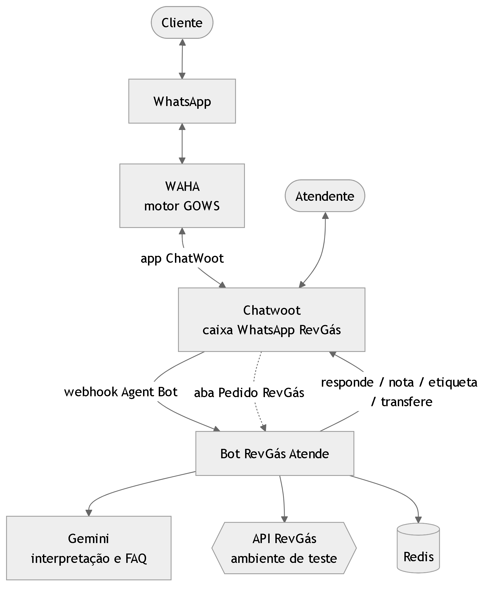
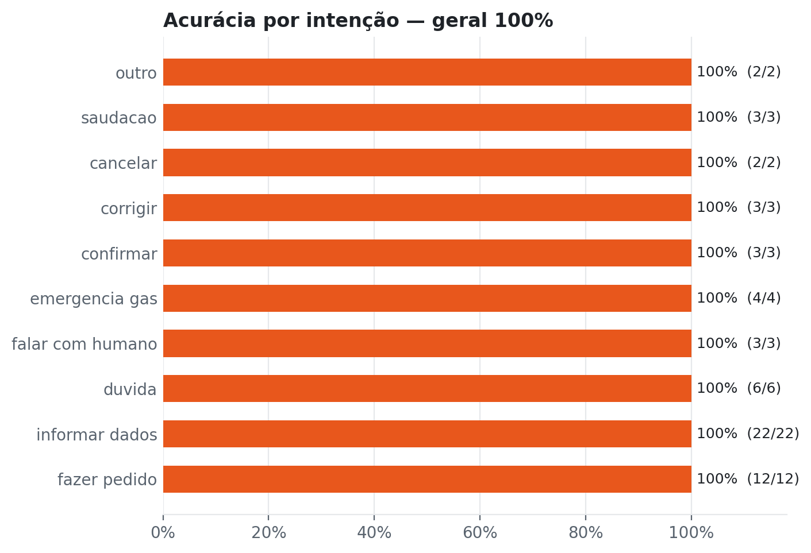
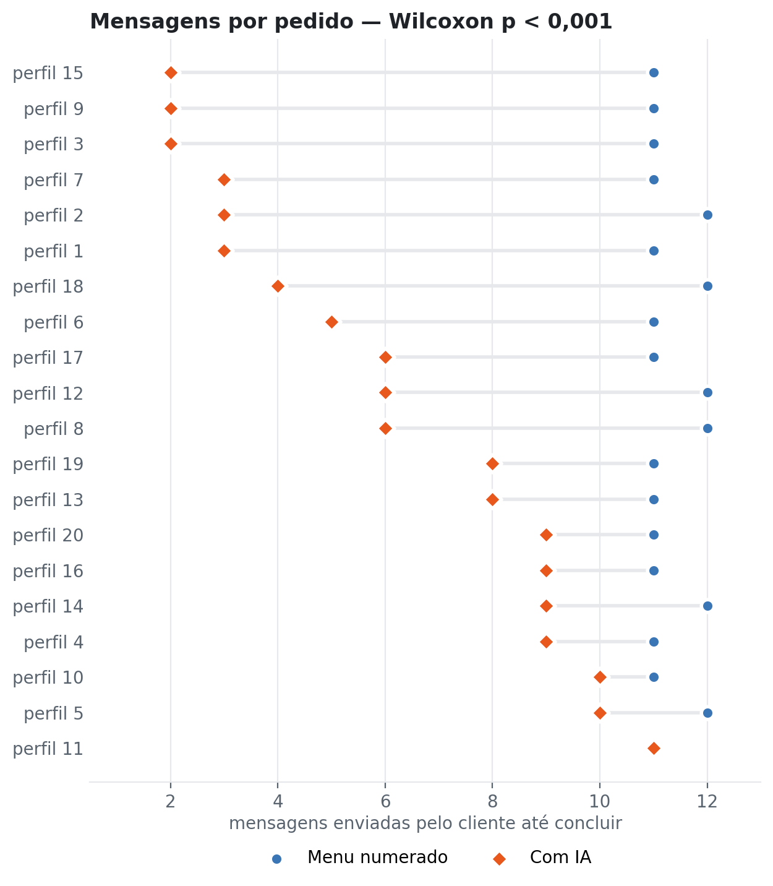
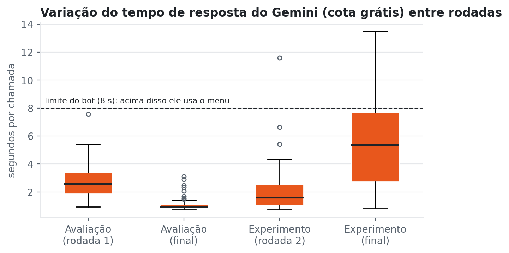

# RevGás Atende — relatório de extensão

Projeto de Extensão VI · Transformação Digital · 2026.2

**Versão para revisão da equipe.** Os resultados quantitativos da avaliação da IA ([issue #2](https://github.com/lucazolvr/revgas-atende/issues/2)) já estão incorporados, e a instalação do zero pelo README e os cinco cenários do ensaio com o WhatsApp real foram validados em 22/11/2026. O vídeo do plano B foi gravado, e o teste com usuários (SUS) foi aplicado em 22/11/2026, com os resultados na seção 5.4. Todas as seções estão completas; falta a revisão da equipe.

**Formato.** Este rascunho já segue a estrutura, as citações (NBR 10520, autor-data) e as referências (NBR 6023) da ABNT. A formatação de página (A4, margens, fonte, espaçamento, paginação) e os elementos pré-textuais (capa, sumário) entram na versão em Word, que segue o modelo de relatório usado pela turma; veja [Para a versão final](#para-a-versão-final-abnt).

## Resumo

Pedidos de gás recebidos pelo WhatsApp costumam ser transcritos à mão para o sistema de gestão da revenda, o que exige conferir dados em dois sistemas e gera retrabalho. Este trabalho apresenta o RevGás Atende, um atendente virtual que coleta e valida o pedido na própria conversa, registra a venda no ERP RevGás somente após a confirmação do cliente e transfere a conversa para um atendente humano no Chatwoot quando necessário. A inteligência artificial (Gemini) interpreta mensagens em texto livre, enquanto preço, produto e criação da venda são decididos pelo código; sem IA, o mesmo fluxo funciona por menus numerados. A avaliação quantitativa usou 60 mensagens rotuladas e um experimento pareado com 20 perfis de cliente. A IA identificou a intenção em 100% das mensagens, extraiu os dados com F1 de 97,2% e reduziu em 45% a mediana de mensagens do cliente em relação ao menu (teste de Wilcoxon, p < 0,001), sem registrar pedidos errados. Os testes também revelaram defeitos, como respostas indevidas em grupos do WhatsApp, e motivaram a troca do conector do WhatsApp. No ensaio de ponta a ponta com o WhatsApp real, os cinco cenários previstos (pedido com IA, pedido pelo menu, dúvida, emergência e resposta do atendente) tiveram o resultado esperado. No teste de usabilidade com dez participantes, a nota SUS média foi de 99,0 pontos (mediana de 100), com efeito teto que limita a interpretação.

**Palavras-chave:** chatbot; atendimento ao cliente; WhatsApp; modelos de linguagem; geração aumentada por recuperação.

## Lista de abreviaturas e siglas

| Sigla | Significado |
| --- | --- |
| API | Interface de programação de aplicações (*Application Programming Interface*) |
| BM25 | *Best Matching 25*, função de ranqueamento por palavras-chave |
| ERP | Sistema integrado de gestão empresarial (*Enterprise Resource Planning*) |
| F1 | Média harmônica entre precisão e revocação |
| FAQ | Perguntas frequentes (*Frequently Asked Questions*) |
| IA | Inteligência artificial |
| LGPD | Lei Geral de Proteção de Dados Pessoais |
| LLM | Modelo de linguagem de grande escala (*Large Language Model*) |
| QR | Código de resposta rápida (*Quick Response*) |
| RAG | Geração aumentada por recuperação (*Retrieval-Augmented Generation*) |
| RRF | Fusão de rankings por posição recíproca (*Reciprocal Rank Fusion*) |
| SUS | Escala de usabilidade de sistemas (*System Usability Scale*) |
| WAHA | *WhatsApp HTTP API*, conector não oficial do WhatsApp |

## 1. Introdução e problema

A equipe identificou que os pedidos de gás recebidos pelo WhatsApp precisam ser transcritos para o ERP RevGás. Esse fluxo exige conferir informações em dois sistemas e pode gerar retrabalho ao corrigir dados incompletos. O projeto investiga como coletar e validar o pedido pelo próprio WhatsApp, registrar a venda após confirmação e transferir a conversa para um atendente quando necessário.

## 2. Revisão bibliográfica

Følstad e Skjuve (2019) entrevistaram usuários de chatbots de atendimento e observaram que respostas adequadas a dúvidas simples e um caminho claro para atendimento humano são importantes para a experiência. No RevGás Atende, isso fundamenta o uso do Chatwoot como destino para conversas que exigem intervenção.

Stepanov e Popov (2025) modelam o atendimento como duas etapas, do chatbot ao agente humano, e consideram o tempo de serviço do chatbot e a espera pela equipe. Isso oferece uma referência para registrar a continuidade do atendimento após a transferência.

Schick et al. (2023) exploram como modelos de linguagem podem selecionar ferramentas e usar suas respostas. Esse trabalho contextualiza o *tool calling*. No RevGás Atende, conforme o design, o Gemini classifica a intenção e extrai dados em formato estruturado. A máquina de estados controla as ações que afetam o pedido, como calcular o total e registrar a venda após a confirmação.

Lewis et al. (2020) combinam geração de texto com recuperação de informação externa. Esse princípio embasa a FAQ do bot, que consulta uma base de conhecimento antes de produzir uma resposta.

## 3. Arquitetura

O cliente conversa no WhatsApp. O WAHA (versão Core, motor GOWS) faz a ponte entre o WhatsApp e o Chatwoot: entrega as mensagens do cliente na caixa "WhatsApp RevGás" e leva ao WhatsApp as respostas do bot e dos atendentes. O Chatwoot aciona o webhook do bot, que roda em Node.js e TypeScript, executa o fluxo de pedido, guarda o estado no Redis e responde pela API do Chatwoot. O bot atende só conversas no privado e ignora grupos. A Figura 1 mostra os componentes e as ligações entre eles.

**Figura 1 – Arquitetura do RevGás Atende**

Fonte: Elaborado pelos autores (2026).

O Gemini interpreta texto livre para os números configurados em `NUMEROS_IA`, que aceita uma lista de números ou `*` para todos, configuração usada no cenário da demonstração. Os números fora da lista são atendidos por menus numerados, e os menus também são o caminho de reserva quando a IA demora ou falha: o mesmo fluxo funciona sem IA. O catálogo fornece produto e preço, que nunca vêm da IA. Dúvidas frequentes são respondidas por uma FAQ com RAG (`src/conhecimento/`). A venda confirmada é criada pela API de teste que a RevGás liberou para a faculdade (estabelecimento de demonstração 2580). Na transferência, a conversa é aberta para a equipe no Chatwoot, com nota-resumo, etiquetas e a aba "Pedido RevGás", que mostra o pedido e a venda no ERP.

Referências internas: [README](../../README.md), [documento de design](../superpowers/specs/2026-11-18-revgas-atende-design.md) e [registro da troca de conector](../decisoes/2026-11-21-troca-evolution-waha.md).

### 3.1 Troca do conector do WhatsApp: da Evolution API para o WAHA

No design de 18/11, a ponte escolhida foi a Evolution API, por ter integração gratuita com o Chatwoot. Nos testes com chip real, em 20 e 21/11/2026, cada versão falhou de um jeito diferente (Quadro 1).

**Quadro 1 – Problemas observados em cada versão da Evolution API**

| Versão da Evolution | Problema observado |
| --- | --- |
| 2.3.7 | O WhatsApp recusava o QR code ("não é possível conectar novos dispositivos no momento"), embora o mesmo número conectasse no WhatsApp Web. |
| 2.3.6 | Conectava, mas as mensagens de remetentes no novo formato de identificação do WhatsApp (`@lid`) não chegavam ao Chatwoot. |
| 2.4.0-rc2 | Passou a exigir licença registrada em servidor externo. Sem ativação, toda chamada respondia `503 LICENSE_REQUIRED`. |

Fonte: Elaborado pelos autores (2026).

A equipe comparou quatro alternativas: registrar a licença da Evolution 2.4, adotar o WAHA Core, migrar para a WhatsApp Cloud API oficial da Meta ou construir uma ponte própria. A escolha foi o WAHA Core, por ser gratuito, sem licença, com integração pronta com o Chatwoot e adequado a um número por instalação. A Cloud API foi descartada nesta versão porque exige conta comercial na Meta e endereço público, enquanto o projeto roda localmente.

No teste de ponta a ponta com o WAHA, a resposta do bot chegou ao WhatsApp em 0,2 a 1,4 s, contra travamentos de 21 a 69 s observados na Evolution. O pedido com IA foi concluído, a venda foi criada na API de teste e a transferência por emergência funcionou. A troca não alterou o bot, porque ele só se comunica com o Chatwoot. Essa decisão mostra a vantagem de isolar o canal: a peça que falhou pôde ser substituída sem mexer na lógica do atendimento. O WAHA continua sendo um conector não oficial, com o mesmo risco de bloqueio do número.

### 3.2 Técnicas propostas e implementadas

O Quadro 2 compara as técnicas apresentadas na disciplina para chatbots com o que foi implementado no RevGás Atende e justifica as que ficaram de fora.

**Quadro 2 – Técnicas propostas para o chatbot e situação no RevGás Atende**

| Técnica | Situação | Como ou por quê |
| --- | --- | --- |
| Classificação de intenção | Implementada | O Gemini classifica a mensagem em intenções fixas (pedido, dúvida, emergência, atendente humano, confirmar, corrigir e cancelar), validadas por esquema. |
| Extração de entidades | Implementada | Produto, quantidade, endereço e pagamento em JSON validado; o que falta é perguntado pelo menu. |
| Memória da conversa | Implementada | O estado da conversa e o pedido em andamento ficam guardados no Redis, por conversa. |
| Transferência para humano | Implementada | A conversa vai para o Chatwoot com nota-resumo, etiquetas e prioridade. |
| Guardrails | Implementada | Preço e produto vêm do catálogo, nunca da IA; a venda só é criada após o “1 - Confirmar”; o RAG recusa responder sem fonte. |
| Tool calling | Parcial, por decisão de projeto | A chamada à API do ERP é feita pelo código, não escolhida pela IA: uma venda é uma ação com efeito real e não pode depender de um modelo. |
| RAG | Implementada | A FAQ responde a partir de trechos recuperados por similaridade de vetores (`gemini-embedding-001`, cosseno, limiar 0,65, até 3 trechos) e recusa responder quando nenhum trecho passa do limiar. |
| RAG híbrido (vetores e palavras-chave) com fusão de rankings | Implementada | A busca vetorial é combinada com palavras-chave por BM25 (Robertson; Zaragoza, 2009), e os dois rankings são unidos por Reciprocal Rank Fusion (Cormack; Clarke; Buettcher, 2009). Em 27 perguntas rotuladas, empatou com a busca só vetorial nos limiares atuais (acerto@1 de 80% × 85%; acerto@3 de 95% × 90%). Com limiar de cosseno 0,70, o híbrido recusa 100% das perguntas fora da FAQ e mantém 75% de acerto@1, contra 50% do vetorial. |
| Query rewriting ou expansion, multi-query, HyDE e HyPE | Não implementadas | A FAQ é pequena (seis temas: área de entrega, horário, pagamento, preço, segurança e troca de botijão), e cada técnica acrescenta uma chamada ao Gemini por pergunta, o que pesa na cota gratuita e na latência. |
| GraphRAG e Agentic RAG | Não implementadas | Pedem uma base com relacionamentos entre documentos ou várias fontes; o escopo tem uma FAQ e uma API. |
| Text-to-SQL controlado | Não se aplica | A RevGás liberou só a API de vendas (ambiente de teste), sem acesso ao banco de dados do ERP. O Postgres do projeto pertence ao Chatwoot, e o Redis guarda as sessões; nenhum dos dois é consultado pela IA. |

Fonte: Elaborado pelos autores (2026).

## 4. Método

O estudo combina métodos quantitativos (avaliação offline e experimento pareado) e qualitativos (observação das sessões e codificação temática das respostas abertas), em abordagem de métodos mistos.

### 4.1 Avaliação quantitativa

Conduzida por Lucas Oliveira em 19/11/2026. O estudo completo está em [avaliacao-ia](avaliacao-ia/README.md).

- **Avaliação offline da IA:** 60 mensagens escritas e rotuladas pela equipe, com gírias, erros de digitação e abreviações. Mede a acurácia de intenção e a precisão, revocação e F1 por campo do pedido (Sokolova; Lapalme, 2009).
- **Experimento pareado, menu × IA:** 20 perfis de cliente fazem o mesmo pedido pelos dois caminhos, por um cliente simulado que conversa com o motor real do bot, com a API de vendas falsa. Hipótese H1: com IA, o cliente conclui o pedido com menos mensagens. Teste de postos sinalizados de Wilcoxon (Wilcoxon, 1945), bicaudal, α = 0,05.
- **Avaliação da busca na FAQ:** conduzida por João Vitor em 22/11/2026, com 27 perguntas rotuladas pela equipe (20 cobertas pela FAQ e 7 de fora). Compara a busca só vetorial com a híbrida pelo acerto@1, pelo acerto@3 e pela recusa correta, com o teste de McNemar exato (McNemar, 1947) nas mesmas perguntas. O estudo completo está em [avaliacao-rag](avaliacao-ia/avaliacao-rag.md).
- **Testes automatizados:** suíte do Vitest, executada com `npm test`, sem rede nem chaves, e cobertura medida com `vitest --coverage`.

### 4.2 Validação de ponta a ponta

Ensaio do roteiro da demo com o WhatsApp real, seguindo o README do zero em um computador da equipe: pedido com IA, pedido pelo menu, dúvida, emergência e resposta do atendente pelo Chatwoot. As vendas de teste são canceladas ao final. O que funcionou e o que falhou é registrado com prints.

### 4.3 Avaliação de usabilidade

Pessoas recrutadas pela equipe fazem a jornada de pedido pelo WhatsApp com o bot em execução, depois de aceitar um termo de consentimento que informa o processamento das mensagens pelo Gemini. O protocolo previa atender os participantes pelo menu, mas, na aplicação de 22/11/2026, o bot rodou com a IA ligada para todos os números (`NUMEROS_IA=*`), e **o teste avaliou o fluxo com interpretação de texto livre**. Aplicar a escala SUS (Brooke, 1996) logo após a tentativa e coletar três respostas abertas. Os itens da escala seguem a versão brasileira validada (Lourenço; Valentim; Lopes, 2022), com uma adaptação: "sistema" foi substituído por "atendimento", para se referir ao atendimento pelo WhatsApp. A nota SUS resume a usabilidade percebida em pontos. A codificação temática (Braun; Clarke, 2006) descreve os motivos relatados para facilidades e dificuldades. O [protocolo de teste](protocolo-sus.md) detalha a tarefa, o instrumento, a pontuação e a análise.

### 4.4 Aspectos éticos e proteção de dados

O estudo segue a Lei Geral de Proteção de Dados Pessoais (Brasil, 2018):

- **Consentimento:** cada participante do teste de usabilidade lê e aceita um termo de consentimento antes da sessão, pode desistir a qualquer momento e é informado de que as mensagens podem ser processadas pelo Gemini na cota gratuita, na qual o Google pode usá-las para melhorar seus produtos.
- **Minimização:** o cenário usa nome e endereço fictícios; o questionário não coleta e-mail nem nome, só o código da sessão (P01 a P08).
- **Anonimização:** os resultados são apresentados por código de sessão, e trechos de respostas abertas são desidentificados.
- **Retenção:** as métricas do bot não guardam texto das mensagens, telefone nem endereço e expiram em 90 dias (`METRICAS_RETENCAO_DIAS`); o material bruto das sessões fica com acesso restrito à equipe e é apagado após a entrega.
- **Dados de negócio:** as vendas usam o cliente de demonstração da API de teste e são canceladas depois.

## 5. Resultados

### 5.1 Resultados quantitativos

**Tabela 1 – Resultados da avaliação quantitativa**

| Medição | Resultado | Evidência |
| --- | --- | --- |
| Intenção e entidades | Intenção 100% (60/60). Entidades com F1 de 97,2% (precisão 94,5%, revocação 100%) | 60 mensagens, `gemini-3.1-flash-lite`. Os 5 erros foram extrações a mais, contidas pelo resumo confirmado pelo cliente |
| Simulação ponta a ponta | 40/40 pedidos concluídos e corretos (20 pelo menu e 20 com IA), sem transferências | Cliente simulado contra o motor real, API RevGás falsa |
| Comparação com e sem IA | Mediana de mensagens do cliente: 11 pelo menu e 6 com IA (−45%). Wilcoxon p = 0,00014, W− = 0, tamanho de efeito r = 1,0 (rank-bisserial) | 20 pares. A IA foi melhor em 19 e empatou em 1. Com IA, o cliente digitou mais caracteres (mediana 110 × 57) |
| Latência da IA | Mediana de 0,9 a 5,4 s por chamada, conforme o horário. Na rodada final da avaliação offline, mediana de 0,92 s e p95 de 2,35 s por mensagem. Na rodada final do experimento, 24% das chamadas passaram do limite de 8 s | Acima de 8 s, o bot recorre ao menu e o atendimento continua |
| Busca na FAQ (RAG) | Híbrido: acerto@1 de 80%, acerto@3 de 95% e recusa correta de 4/7. Só vetorial: 85%, 90% e 4/7. McNemar exato p = 1,0 (1 pergunta discordante) | 27 perguntas rotuladas (20 da FAQ e 7 de fora), com os limiares do bot |
| Testes automatizados | 155 testes em 18 arquivos, todos passando. Cobertura de 63% das linhas de `src/`: conversa 94%, vendas 98%, canal 97% e painel 90% | `npm test` e `vitest --coverage` em 22/11, sem rede (IA e ERP falsos). Os módulos que chamam o Gemini (ia 56%, conhecimento 58%) são avaliados à parte, com a IA real; as páginas do painel não têm teste automatizado |

Fonte: Elaborado pelos autores (2026).

Os números da IA são da versão do bot medida em 19/11; os da FAQ e dos testes, de 22/11. Depois disso, o bot passou a deduzir o estado pela cidade e a perguntar cidade e estado juntos, o que reduz o caminho pelo menu de 11 para 10 mensagens em um pedido em Teresina.

A Figura 2 mostra a acurácia por intenção; a Figura 3 compara, para cada perfil, o número de mensagens até concluir o pedido pelos dois caminhos; e a Figura 4 mostra a variação do tempo de resposta do Gemini entre as rodadas, com o limite de 8 s do bot.

**Figura 2 – Acurácia por intenção (60 mensagens)**

Fonte: Elaborado pelos autores (2026), a partir do estudo de avaliação da IA.

**Figura 3 – Mensagens até concluir o pedido, por perfil, pelo menu e com IA**

Fonte: Elaborado pelos autores (2026), a partir do estudo de avaliação da IA.

**Figura 4 – Tempo por chamada ao Gemini em cada rodada**

Fonte: Elaborado pelos autores (2026), a partir do estudo de avaliação da IA.

### 5.2 Falhas reveladas pelos testes

Os testes encontraram defeitos que os testes unitários não tinham encontrado:

- **Simulação (19/11):** sem IA, frases como "meu nome é Ana" eram gravadas inteiras como nome. Em outro caso, a IA interpretava o bairro como rua, porque não sabia qual campo tinha sido perguntado, e a conversa entrava em ciclo. Os dois defeitos foram corrigidos antes da rodada final.
- **Conector do WhatsApp (20 e 21/11):** as falhas da Evolution levaram à troca pelo WAHA (seção 3.1).
- **Teste com WhatsApp real (21/11):** o WAHA repassa ao Chatwoot também as mensagens de grupos, e o bot respondia dentro deles. Desde o [PR #19](https://github.com/lucazolvr/revgas-atende/pull/19), o bot ignora grupos e só atende no privado.
- **Reconexão:** depois de várias conexões seguidas, o WhatsApp passou a recusar novos aparelhos também no WAHA. Zerar a sessão e ler o QR de novo resolveu.
- **Dois computadores no mesmo chip (22/11):** com duas instalações conectadas ao mesmo número, os dois bots respondiam ao cliente, um deles com uma versão desatualizada. A regra passou a ser um computador por vez no chip, registrada no guia de atualização do ambiente e no roteiro da demo.

### 5.3 Validação de ponta a ponta

**Instalação do zero (22/11/2026).** Em um notebook com Windows 11 e 7,8 GB de RAM, a instalação pelo README foi concluída: os containers subiram, o `npm run setup` criou o bot, a caixa de entrada e a sessão do WhatsApp, o chip da revenda foi conectado e o bot respondeu a um “oi” vindo de outro número. Seis pontos travaram ou confundiram quem seguia o README pela primeira vez: o download das imagens do Docker falhou e depois travou; o `.env` repassado pela equipe ainda era da Evolution; o identificador da conta do Chatwoot saiu diferente do valor do exemplo; o bot reinicia em ciclo até existir o token do setup, sem aviso no README; a sessão do WhatsApp expira antes de a pessoa abrir o QR; e o celular recusou a primeira leitura do QR. Os detalhes e as sugestões de correção estão no [roteiro da demo](../roteiro-demo.md#instalação-do-zero-22112026).

**Cenários do roteiro (22/11/2026).** Os cinco cenários foram executados com o WhatsApp real, a partir de dois números de teste (um em `NUMEROS_IA` e outro fora), e todos tiveram o resultado esperado (Quadro 3).

**Quadro 3 – Resultado dos cenários do ensaio de ponta a ponta**

| Cenário | Resultado |
| --- | --- |
| Pedido com IA | Concluído. Com uma única mensagem, a IA extraiu produto, quantidade, endereço e pagamento, e o estado (PI) foi deduzido da cidade; o bot perguntou apenas o nome. A venda foi criada após a confirmação, com o total do catálogo (R$ 220,00). |
| Pedido pelo menu | Concluído em nove etapas de menu, com venda criada (R$ 440,00) e exibida na aba “Pedido RevGás” e em “Pedidos de hoje”. |
| Dúvida (FAQ) | A pergunta sobre entrega no domingo foi respondida pela base de conhecimento, e o bot retomou o pedido em seguida. |
| Emergência | Orientações de segurança imediatas; a conversa foi transferida à equipe com prioridade urgente, etiquetas `vazamento` e `urgente` e nota-resumo. |
| Resposta do atendente | A mensagem enviada pelo Chatwoot chegou ao WhatsApp do cliente no mesmo minuto. |

Fonte: Elaborado pelos autores (2026).

O ensaio também confirmou a correção do PR #19: mensagens de um grupo em que o chip participa chegaram ao Chatwoot, e o bot não respondeu. As três vendas de teste do dia foram canceladas na API de teste. Duas observações foram registradas para o roteiro e para o teste com usuários: no pedido pelo menu, a rua foi respondida em duas linhas e o bot guardou o texto inteiro como rua; o resumo exibiu o erro, mas o pedido foi confirmado mesmo assim, o que mostra que a proteção do resumo depende de a pessoa lê-lo. E, no Chatwoot, as conversas atendidas pelo bot ficam com status “pendente” e não aparecem no filtro padrão “Abertas”, o que precisa ser ajustado por quem opera o painel na demonstração.

### 5.4 Avaliação pelo SUS e respostas abertas

**Sessões.** As sessões aconteceram em 22/11/2026, entre 21h43 e 22h25, com o bot em execução no computador de um integrante da equipe e a IA ligada para todos os números (`NUMEROS_IA=*`). O formulário recebeu dez questionários completos, identificados de P01 a P10, todos com o termo de consentimento aceito; o piloto (P00) não foi registrado. No Chatwoot, foram registradas oito conversas de participantes, e todas terminaram em venda confirmada, sem transferência para atendente (Tabela 3). A diferença entre dez questionários e oito conversas não pôde ser esclarecida, porque, para preservar o anonimato, as conversas não foram ligadas aos códigos do formulário.

**Tabela 3 – Conversas registradas nas sessões do teste com usuários**

| Conversa | Início | Mensagens do cliente | Tempo até a venda | Resultado |
| --- | --- | ---: | ---: | --- |
| 1 | 21h43 | 9 | 1,7 min | Venda |
| 2 | 21h44 | 10 | 3,7 min | Venda |
| 3 | 21h44 | 9 | 2,3 min | Venda |
| 4 | 21h48 | 10 | 11,6 min | Venda |
| 5 | 21h56 | 4 | 0,6 min | Venda |
| 6 | 21h59 | 9 | 1,4 min | Venda |
| 7 | 22h06 | 10 | 3,1 min | Venda |
| 8 | 22h14 | 9 | 2,0 min | Venda |

Fonte: Elaborado pelos autores (2026).

A mediana foi de 9 mensagens (de 4 a 10) e de 2,2 minutos até a venda (de 0,6 a 11,6 minutos; média de 3,3 minutos, ou 2,1 sem a conversa mais longa). Com pessoas reais, o caminho com IA ficou entre os dois resultados do experimento com cliente simulado (mediana de 6 mensagens com IA e de 11 pelo menu), o que é coerente com a observação de que pessoas reais nem sempre mandam o pedido completo numa única mensagem. As oito vendas de teste foram registradas na API de teste da RevGás e canceladas depois das sessões.

**Nota SUS.** A nota de cada sessão foi calculada como em Brooke (1996), de 0 a 100 pontos. A média foi de 99,0 pontos, a mediana de 100 e o intervalo observado de 90 a 100 (desvio-padrão de 3,2). Nove participantes deram a nota máxima (Tabela 2).

**Tabela 2 – Nota SUS por sessão**

| Sessão | P01 | P02 | P03 | P04 | P05 | P06 | P07 | P08 | P09 | P10 |
| --- | ---: | ---: | ---: | ---: | ---: | ---: | ---: | ---: | ---: | ---: |
| Nota SUS | 100 | 100 | 100 | 100 | 90 | 100 | 100 | 100 | 100 | 100 |

Fonte: Elaborado pelos autores (2026).

**Leitura dos resultados.** As notas indicam que nenhum participante percebeu problema de usabilidade relevante na jornada, mas o resultado precisa ser lido com cautela. Nove dos dez questionários têm exatamente o mesmo padrão, com 5 em todas as afirmações positivas e 1 em todas as negativas, o que caracteriza efeito teto: a escala não distingue diferenças entre os participantes. Esse padrão também é compatível com respostas dadas sem a leitura atenta de cada item e com o viés de desejabilidade social, já que os participantes foram recrutados pela equipe e responderam logo após uma sessão moderada. A única divergência foi no item 4 da sessão P05 (“precisaria de ajuda de uma pessoa técnica”), marcado com 5 enquanto todos os outros itens tiveram a avaliação mais favorável. Não é possível saber se a pessoa sentiu necessidade de ajuda ou se leu o item negativo como positivo, um erro conhecido em escalas que alternam itens positivos e negativos.

**Respostas abertas.** As respostas foram curtas, e três participantes deixaram pelo menos uma pergunta em branco ou com um ponto. A codificação temática (Braun; Clarke, 2006) resultou em cinco temas (Quadro 4). Nenhum participante relatou dificuldade nem sugeriu mudança.

**Quadro 4 – Temas das respostas abertas**

| Tema | Códigos associados | Pessoas distintas | Evidência desidentificada |
| --- | --- | --- | --- |
| Processo fácil e bem guiado | facilidade geral, explicação clara, condução pelo bot | 5 (P01, P03, P04, P05, P10) | “Todo o pedido foi fácil, intuitivo e muito bem guiado pelo bot” |
| Rapidez e praticidade | resposta rápida, prático | 3 (P02, P05, P08) | “muito rápido a resposta” |
| Clareza do produto, do valor e da confirmação | produto e valor claros, confirmação, forma de pagamento | 2 (P02, P09) | “identificar o produto e o seu valor” |
| Ausência de dificuldade | nenhuma dificuldade relatada | 10 (todos) | “Não tive momentos de dificuldade” |
| Nenhuma mudança sugerida | “nada”, “está perfeito”, sem ajustes | 7 (P01 a P05, P08, P10); 3 sem resposta (P06, P07, P09) | “Não acho que precise de ajustes” |

Fonte: Elaborado pelos autores (2026).

**Ajustes propostos.** Como as sessões não apontaram dificuldades, os ajustes vêm do ensaio de ponta a ponta (seção 5.3), como tratar respostas de rua com várias linhas. Para que um próximo teste discrimine melhor a usabilidade, recomenda-se recrutar pessoas de fora do círculo da equipe, incluir tarefas com correção de dados e troco e registrar a observação de cada sessão junto com o questionário.

## 6. Limitações

As ameaças à validade do estudo quantitativo seguem a classificação de Wohlin et al. (2012) e estão detalhadas no [estudo de avaliação](avaliacao-ia/README.md#5-ameaças-à-validade). As principais limitações do trabalho são:

- **Conector não oficial:** o WAHA, assim como a Evolution, não é a API oficial do WhatsApp. A disponibilidade do canal depende da sessão, e o número pode ser bloqueado. O caminho para produção é a WhatsApp Cloud API.
- **Cota gratuita do Gemini:** a latência variou muito entre horários, e as mensagens podem ser usadas pelo Google. Por isso, a IA para pessoas de fora da equipe só foi usada com aviso: na demonstração e no teste com usuários, em que o termo de consentimento informa o processamento pelo Gemini. Para clientes reais, seria necessário um plano pago.
- **Dados da avaliação:** as mensagens e os perfis foram escritos pela equipe, e o cliente simulado responde sempre de forma cooperativa. Pessoas reais erram, mudam de ideia e mandam áudio.
- **Ambiente de demonstração:** todas as vendas usam o cliente de demonstração da API de teste. Os dados da FAQ (horário, área de entrega, pagamento) são fictícios ([dados de demonstração](../dados-de-demonstracao.md)).
- **Desvio do protocolo:** o teste com usuários foi planejado para o fluxo por menus, mas foi aplicado com a IA ligada; o SUS mede, portanto, o atendimento com interpretação de texto livre, e os dois fluxos não foram comparados com pessoas reais.
- **Amostra e efeito teto:** o teste com usuários teve dez participantes recrutados pela equipe, uma amostra pequena e de conveniência. Quase todas as respostas ficaram na nota máxima, o que impede comparar participantes e sugere viés de desejabilidade social. O teste permite afirmar que não surgiram problemas graves na jornada observada, com alcance limitado para generalizações.

## 7. Conclusão

A proposta conecta um fluxo de pedido no WhatsApp a regras de validação e a atendimento humano no Chatwoot. A avaliação quantitativa confirmou que a interpretação por IA reduz o número de mensagens sem registrar pedidos errados, e que o sistema continua atendendo pelo menu quando a IA falha ou demora. A troca do conector mostrou a vantagem de manter o canal isolado da lógica do bot. O ensaio com o WhatsApp real, seguindo o README do zero, mostrou o fluxo completo funcionando, do pedido à venda e da emergência à resposta humana, e apontou ajustes de documentação e de operação que facilitam a instalação e a demonstração.

O teste com usuários não revelou dificuldades: os dez participantes avaliaram o atendimento com nota SUS média de 99,0, e nenhum relatou problema nas respostas abertas. Como as notas ficaram no teto e a amostra foi de conveniência, o resultado mostra a ausência de problemas graves na jornada testada, e não uma medida precisa de usabilidade. Um próximo ciclo deve incluir pessoas de fora do círculo da equipe e tarefas com correção de dados.

## Referências

BRASIL. Lei nº 13.709, de 14 de agosto de 2018. Lei Geral de Proteção de Dados Pessoais (LGPD). Brasília, DF: Presidência da República, 2018. Disponível em: <https://www.planalto.gov.br/ccivil_03/_ato2015-2018/2018/lei/l13709.htm>. Acesso em: 22 nov. 2026.

BRAUN, V.; CLARKE, V. Using thematic analysis in psychology. **Qualitative Research in Psychology**, [*s. l.*], v. 3, n. 2, p. 77-101, 2006. DOI: <https://doi.org/10.1191/1478088706qp063oa>.

BROOKE, J. SUS: a quick and dirty usability scale. *In*: JORDAN, P. W. *et al.* (ed.). **Usability evaluation in industry**. London: Taylor & Francis, 1996. p. 189-194. Disponível em: <https://hci-studies.org/methods-and-measures/downloads/SUS_Brooke1996.pdf>. Acesso em: 22 nov. 2026.

CORMACK, G. V.; CLARKE, C. L. A.; BUETTCHER, S. Reciprocal rank fusion outperforms Condorcet and individual rank learning methods. *In*: INTERNATIONAL ACM SIGIR CONFERENCE ON RESEARCH AND DEVELOPMENT IN INFORMATION RETRIEVAL, 32., 2009, Boston. **Proceedings** [...]. New York: ACM, 2009. p. 758-759. DOI: <https://doi.org/10.1145/1571941.1572114>.

FØLSTAD, A.; SKJUVE, M. Chatbots for customer service: user experience and motivation. *In*: INTERNATIONAL CONFERENCE ON CONVERSATIONAL USER INTERFACES, 1., 2019, Dublin. **Proceedings** [...]. New York: ACM, 2019. p. 1-9. DOI: <https://doi.org/10.1145/3342775.3342784>.

LEWIS, P. *et al.* Retrieval-augmented generation for knowledge-intensive NLP tasks. *In*: CONFERENCE ON NEURAL INFORMATION PROCESSING SYSTEMS, 34., 2020, [*s. l.*]. **Advances in Neural Information Processing Systems**. [*S. l.*]: Curran Associates, 2020. v. 33, p. 9459-9474. Disponível em: <https://proceedings.neurips.cc/paper/2020/hash/6b493230205f780e1bc26945df7481e5-Abstract.html>. Acesso em: 22 nov. 2026.

LOURENÇO, D. F.; VALENTIM, E. C.; LOPES, M. H. B. M. Tradução e adaptação transcultural da System Usability Scale para o português do Brasil. **Aquichan**, Chía, v. 22, n. 2, p. 1-16, 2022. DOI: <https://doi.org/10.5294/aqui.2022.22.2.8>.

MCNEMAR, Q. Note on the sampling error of the difference between correlated proportions or percentages. **Psychometrika**, [*s. l.*], v. 12, n. 2, p. 153-157, 1947. DOI: <https://doi.org/10.1007/BF02295996>.

ROBERTSON, S.; ZARAGOZA, H. The probabilistic relevance framework: BM25 and beyond. **Foundations and Trends in Information Retrieval**, [*s. l.*], v. 4, n. 1-2, p. 1-174, 2009. DOI: <https://doi.org/10.1561/1500000019>.

SCHICK, T. *et al.* Toolformer: language models can teach themselves to use tools. *In*: CONFERENCE ON NEURAL INFORMATION PROCESSING SYSTEMS, 37., 2023, New Orleans. **Advances in Neural Information Processing Systems**. [*S. l.*]: Curran Associates, 2023. v. 36, p. 68539-68551. Disponível em: <https://proceedings.neurips.cc/paper_files/paper/2023/hash/d842425e4bf79ba039352da0f658a906-Abstract-Conference.html>. Acesso em: 22 nov. 2026.

SOKOLOVA, M.; LAPALME, G. A systematic analysis of performance measures for classification tasks. **Information Processing & Management**, [*s. l.*], v. 45, n. 4, p. 427-437, 2009. DOI: <https://doi.org/10.1016/j.ipm.2009.03.002>.

STEPANOV, M. S.; POPOV, V. G. The analysis of contact center model with two service stages and chatbot service time taken into account. *In*: INTERNATIONAL CONFERENCE ON INFORMATION, CONTROL, AND COMMUNICATION TECHNOLOGIES, 9., 2025, Gomel. **Proceedings** [...]. [*S. l.*]: IEEE, 2025. p. 1-5. DOI: <https://doi.org/10.1109/ICCT67028.2025.11427476>.

WILCOXON, F. Individual comparisons by ranking methods. **Biometrics Bulletin**, [*s. l.*], v. 1, n. 6, p. 80-83, 1945. DOI: <https://doi.org/10.2307/3001968>.

WOHLIN, C. *et al.* **Experimentation in software engineering**. Berlin: Springer, 2012. DOI: <https://doi.org/10.1007/978-3-642-29044-2>.

## Para a versão final (ABNT)

Checklist para montar o documento entregue, conforme a issue [#4](https://github.com/lucazolvr/revgas-atende/issues/4). A faculdade não tem modelo próprio; a turma usa como referência o relatório final de outro grupo da disciplina, que define a capa e a ordem dos elementos.

- [x] **Ferramenta:** Word, gerado a partir deste rascunho (decisão da equipe).
- [x] **Pré-textuais, no modelo da turma:** capa (instituição, curso, Projeto de Extensão VI, professor, nomes completos da equipe, título, Teresina, 2026), resumo e palavras-chave, lista de abreviaturas e siglas e sumário (NBR 6027).
- [x] **Página:** A4; margens de 3 cm em cima e à esquerda e de 2 cm embaixo e à direita; Arial ou Times New Roman 12 no texto e 10 em citações longas, notas, legendas e fontes; espaçamento 1,5 no texto e simples em citações longas, referências e legendas.
- [x] **Paginação:** contada a partir da página seguinte à capa (não há folha de rosto no modelo da turma) e mostrada a partir da introdução, no canto superior direito.
- [x] **Seções:** numeração progressiva (NBR 6024), com as seções primárias e secundárias em maiúsculas no sumário, e listas como alíneas a), b), c).
- [x] **Figuras e tabelas:** título acima (“Figura 1 – Acurácia por intenção”) e fonte abaixo (“Fonte: Elaborado pelos autores (2026).”). As 7 figuras do [estudo de avaliação](avaliacao-ia/figuras/) estão em 200 dpi e podem entrar direto.
- [x] **Referências:** em ordem alfabética, alinhadas à esquerda, espaçamento simples e uma linha em branco entre elas (NBR 6023). Só entram obras citadas no texto.
- [ ] **Pós-textuais:** apêndices com o [protocolo de teste](protocolo-sus.md) e o questionário SUS, e com o [roteiro da demo](../roteiro-demo.md), se a equipe quiser.
- [x] **Dados fictícios declarados:** horário, bairros e regras da FAQ são de demonstração; as métricas são reais ([dados de demonstração](../dados-de-demonstracao.md)).
