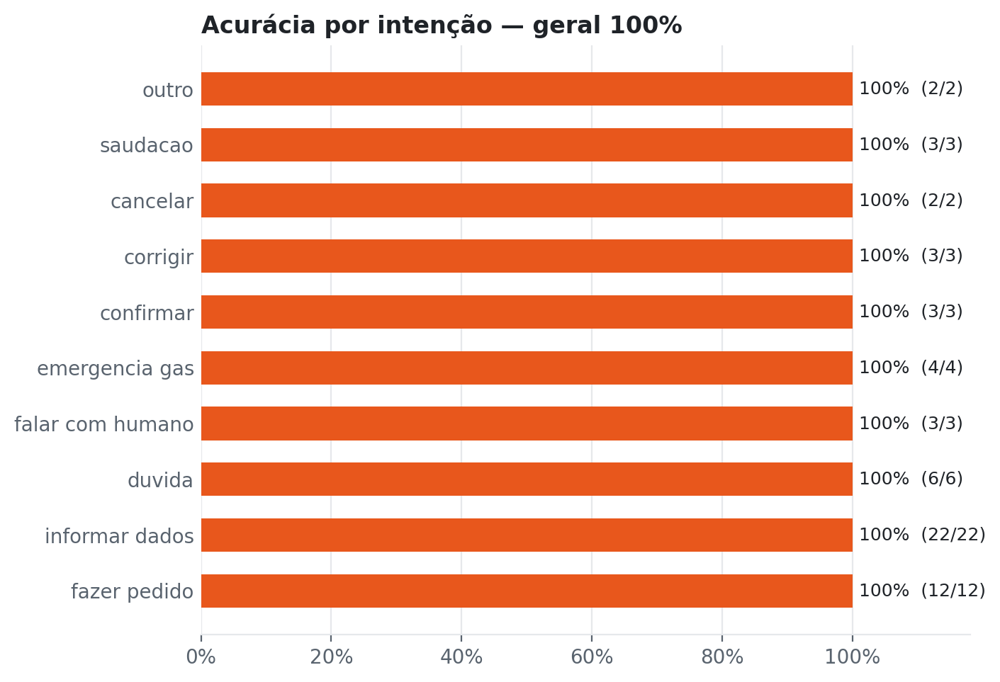
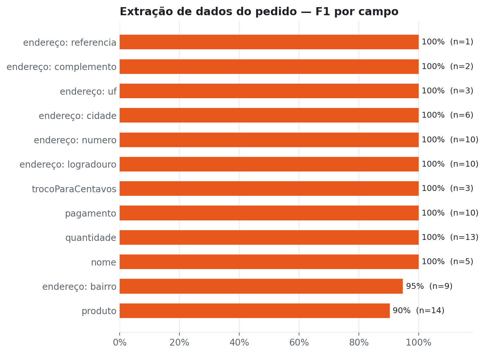
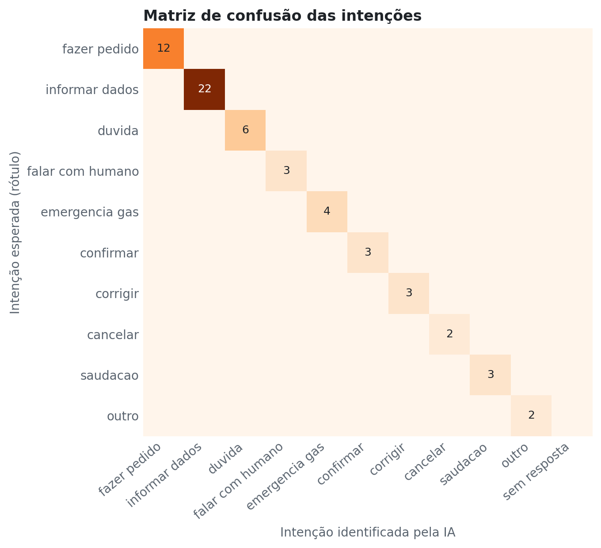
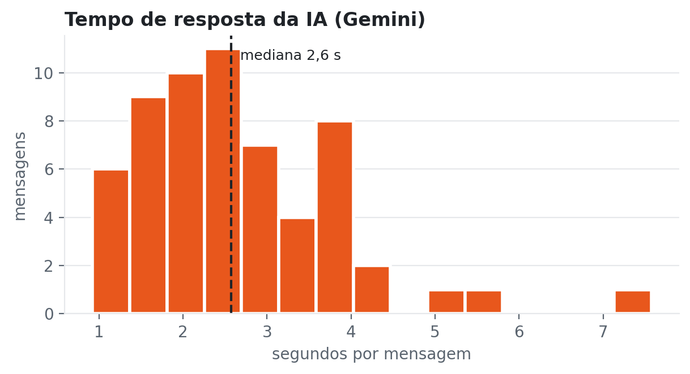
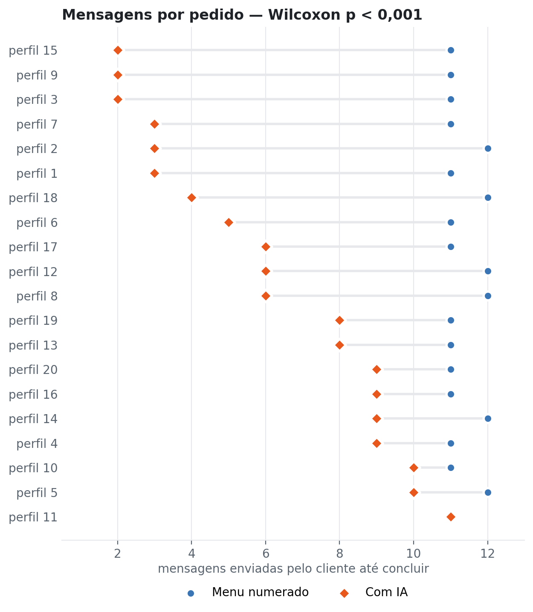
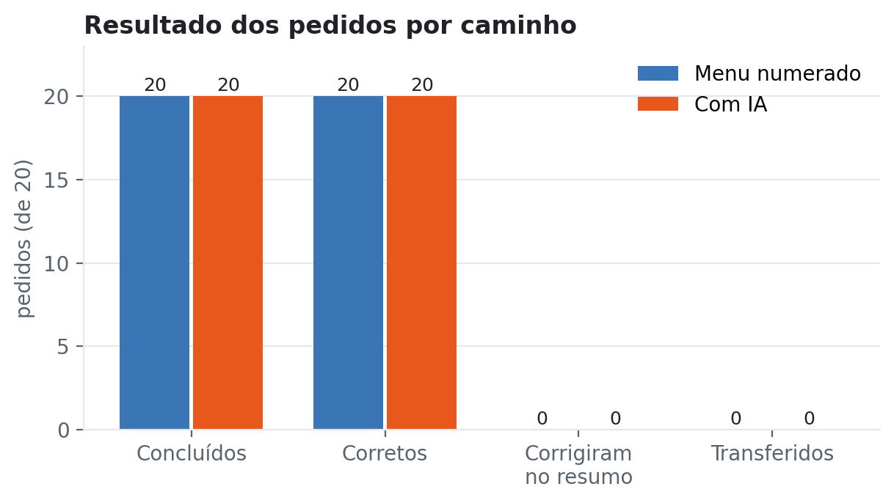
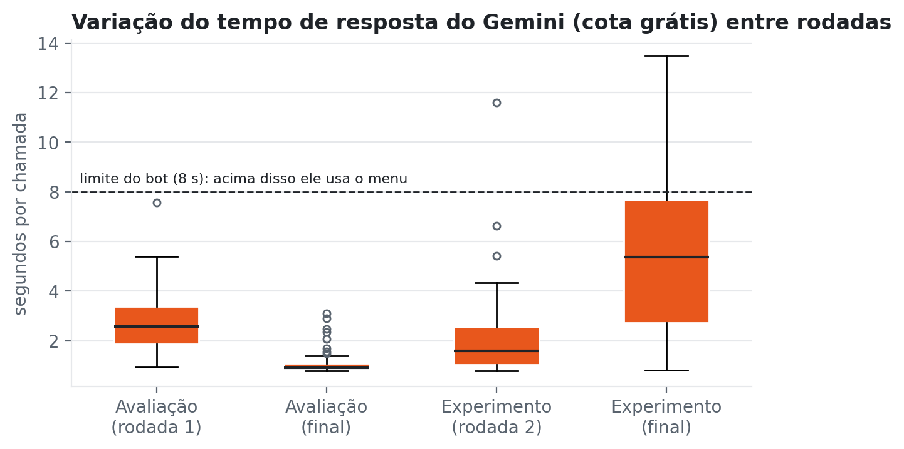

# Avaliação da IA e experimento com/sem IA

**RevGás Atende** · Projeto de Extensão VI · Transformação Digital · 2026.2
Entrega da issue [#2](https://github.com/lucazolvr/revgas-atende/issues/2) · Responsável: Lucas Oliveira · Execução: 19/11/2026

---

## Resumo

Este estudo avalia, de forma quantitativa, o componente de inteligência artificial do RevGás Atende, o atendente virtual que recebe pedidos de gás pelo WhatsApp e registra a venda no ERP RevGás. Foram feitas duas avaliações complementares:

1. **Avaliação offline da interpretação.** O modelo `gemini-3.1-flash-lite` interpretou 60 mensagens rotuladas pela equipe. Ele identificou a **intenção correta em 100% delas (60/60)** e extraiu os dados do pedido com **F1 de 97,2%** (precisão 94,5%, revocação 100%; 86 campos esperados).
2. **Experimento pareado, menu numerado × texto livre com IA.** Vinte perfis de cliente fizeram o mesmo pedido pelos dois caminhos, contra o motor real do bot. Com IA, a mediana de mensagens do cliente caiu de **11 para 6 (−45%)**. A IA foi igual ou melhor em todos os pares, e o teste de Wilcoxon rejeitou a hipótese nula (**p = 0,00014**). Os dois caminhos registraram **20/20 pedidos corretos**.

O estudo também **encontrou e corrigiu três defeitos** no bot e nas ferramentas antes da rodada final, e revelou um risco operacional. Na cota grátis do Gemini, o tempo de resposta variou de **0,9 s a 5,4 s** (mediana por rodada). Na rodada final, 24% das chamadas passaram do limite de 8 s, a partir do qual o bot recorre ao menu.

---

## 1. Objetivo e questões de pesquisa

O bot usa IA **apenas para interpretar** o texto do cliente (intenção e dados do pedido). Preço, validação, estado do pedido e criação da venda ficam no código (ver o [documento de design](../../superpowers/specs/2026-11-18-revgas-atende-design.md)). Por isso o estudo responde a três perguntas:

| | Questão | Como foi medida |
|---|---|---|
| **QP1** | A IA entende corretamente o que o cliente quer e extrai os dados do pedido? | Avaliação offline: acurácia de intenção; precisão, revocação e F1 por campo |
| **QP2** | Aceitar texto livre com IA reduz o esforço do cliente em relação ao menu numerado? | Experimento pareado: mensagens até concluir (H1), caracteres digitados |
| **QP3** | O pedido continua correto e o atendimento continua de pé quando a IA erra, demora ou fica indisponível? | Corretude do pedido registrado, transferências e latência |

## 2. Método

### 2.1 Avaliação offline da interpretação (QP1)

**Conjunto de dados** (`eval/mensagens.jsonl`). São 60 mensagens **escritas e rotuladas pela equipe**, imitando o modo como clientes de revenda de gás escrevem no WhatsApp:
- gírias ("manda um bujão", "me vê 3 gás");
- erros de digitação ("dinhero", "pics", "gaz");
- abreviações ("av.", "r.", "apto", "thé-pi");
- frases incompletas e emojis.

Cada mensagem tem a **etapa da conversa** em que foi enviada (por exemplo `ENDERECO`, `PAGAMENTO`, `RESUMO`), porque a mesma frase muda de sentido conforme a etapa.

| Intenção | Mensagens | | Intenção | Mensagens |
|---|---:|---|---|---:|
| informar_dados | 22 | | falar_com_humano | 3 |
| fazer_pedido | 12 | | confirmar | 3 |
| duvida | 6 | | corrigir | 3 |
| emergencia_gas | 4 | | cancelar | 2 |
| saudacao | 3 | | outro | 2 |

**Regras de rotulagem.**
- Uma entidade só é rotulada se o cliente a disse.
- "Botijão", "gás" e "bujão" sem tamanho equivalem ao P13.
- "Cartão" sem tipo **não** define forma de pagamento.
- "Troco pra 200" = 20000 centavos.

Um teste automatizado garante que todo rótulo é aceito pelo próprio validador do bot (`tests/eval/avaliar-ia.test.ts`).

**Métricas.**
- **Intenção:** acurácia (acertos ÷ total) e matriz de confusão.
- **Entidades:** comparação campo a campo, em 12 campos (nome, produto, quantidade, pagamento, troco e 7 partes do endereço):
  - **VP** = extraiu o valor certo;
  - **FP** = extraiu um valor que não devia;
  - **FN** = não extraiu um valor esperado;
  - valor errado conta como FP **e** FN.

  Precisão = VP/(VP+FP), revocação = VP/(VP+FN) e F1 = média harmônica das duas (Sokolova; Lapalme, 2009). Também é reportada a média *micro* de todos os campos.
- **Normalização na comparação:** a comparação ignora maiúsculas, acentos e pontuação e trata abreviações como equivalentes ("Av." = "Avenida", "R." = "Rua", "apto" = "apartamento"), para não penalizar a IA por escrever o mesmo endereço de outro jeito. Há teste para isso, inclusive garantindo que "Regeneração" não vira "Rua...".

### 2.2 Experimento pareado: menu × IA (QP2 e QP3)

**Hipóteses.**
- **H1:** com interpretação por IA, o cliente conclui o pedido com menos mensagens do que pelo menu numerado.
- **H0:** não há diferença no número de mensagens.

**Desenho.** É um experimento **pareado (dentro de sujeitos)**. Cada um dos 20 perfis (`eval/perfis.json`) faz **o mesmo pedido** nas duas condições, o que elimina a variação entre pedidos:

| Condição | O que acontece |
|---|---|
| **Controle: menu** | O bot pergunta um dado por vez e o cliente responde pelos números do menu e com textos curtos |
| **Tratamento: IA** | O cliente começa com uma frase livre (ex.: *"quero 1 gas pra rua coelho de resende 1520 ilhotas teresina pi, dinheiro, troco pra 200"*) e responde às perguntas restantes com palavras |

**Perfis.** São 20 pedidos variados:
- 1 a 4 botijões;
- quatro formas de pagamento, com e sem troco;
- Teresina/PI e Timon/MA;
- abertura de conversa desde completa (todos os dados numa frase) até mínima ("gas").

**Cliente simulado** (`eval/cliente-simulado.ts`). Ele conversa com o **motor real do bot** (a mesma função `processar()` usada em produção), sem Chatwoot e sem ERP:
- responde à pergunta da etapa atual a partir do perfil;
- no resumo, **confere todos os campos**: se algo estiver errado, pede correção, como faria uma pessoa;
- a conversa termina quando a venda é registrada, quando há transferência para humano ou ao atingir 25 mensagens.

**Variáveis medidas.**

| Variável | Definição |
|---|---|
| Mensagens | Número de mensagens enviadas pelo cliente até concluir (**variável principal de H1**) |
| Caracteres | Total de caracteres digitados pelo cliente |
| Pedido correto | O pedido registrado é idêntico ao perfil (nome, produto, quantidade, endereço, pagamento e troco) |
| Correções | Vezes que o cliente pediu "corrigir" no resumo |
| Tempo do bot | Soma do tempo das chamadas ao Gemini no pedido (sem as pausas da cota) |

**Teste estatístico.** Foi usado o teste de postos sinalizados de **Wilcoxon** (Wilcoxon, 1945), bicaudal, com α = 0,05, aproximação normal e correções de continuidade e de empates. Ele foi escolhido porque:
- as amostras são **pareadas**;
- o n é pequeno (20);
- os dados são contagens discretas com muitos empates no menu (11 ou 12), o que viola a normalidade exigida pelo teste *t*.

A implementação (`eval/estatistica.ts`) foi conferida contra o `scipy.stats.wilcoxon`, com o mesmo valor-p até a quarta casa decimal.

### 2.3 Ambiente e controle

| Item | Valor |
|---|---|
| Modelo | `gemini-3.1-flash-lite` (Google AI Studio, **cota grátis**) |
| Configuração | temperatura 0, saída estruturada em JSON (*response schema*), validação de esquema no bot |
| Limite de tempo | 15 s por chamada na avaliação; o bot em produção usa 8 s e cai no menu acima disso |
| Cota | intervalo de 4,5 s entre chamadas; erro transitório (429/503) é repetido e contado à parte como "indisponível" |
| Software | Node 22.14, TypeScript, Vitest 5.1, `@google/genai` 3.5 |
| Execução | 19/11/2026, branch `feat/2-avaliacao-ia` |

### 2.4 Testes automatizados

A suíte roda com `npm test` e tem **72 testes em 12 arquivos, todos passando**, sem rede nem chaves (IA e ERP falsos):

| Área | Testes |
|---|---:|
| Motor da conversa (fluxo, correções, emergência, fallback sem IA) | 16 |
| Vendas (catálogo, total, corpo da venda, API RevGás, sem duplicar) | 12 |
| Avaliação (métricas, Wilcoxon, conjunto, cliente simulado, experimento) | 17 |
| Canal Chatwoot e servidor (webhook, transferência, concorrência) | 13 |
| IA (validação da resposta), configuração e marca | 14 |

## 3. Resultados

### 3.1 Interpretação (QP1)

**Intenção: 100% de acurácia (60/60).** A matriz de confusão (Figura 3) é puramente diagonal. Nenhuma emergência de gás, pedido de atendente ou cancelamento foi confundido.



*Figura 1. Acurácia por intenção (60 mensagens).*

**Entidades: F1 micro de 97,2%** (precisão 94,5%, revocação 100%, 86 campos esperados). Revocação de 100% significa que a IA **não deixou de captar nenhum dado** que o cliente informou. Todos os 5 erros são **extrações a mais** (FP).

| Campo | Suporte | VP | FP | FN | Precisão | Revocação | F1 |
|---|---:|---:|---:|---:|---:|---:|---:|
| nome | 5 | 5 | 0 | 0 | 100% | 100% | 100% |
| produto | 14 | 14 | 2 | 0 | 87,5% | 100% | 93,3% |
| quantidade | 13 | 13 | 0 | 0 | 100% | 100% | 100% |
| pagamento | 10 | 10 | 2 | 0 | 83,3% | 100% | 90,9% |
| troco | 3 | 3 | 0 | 0 | 100% | 100% | 100% |
| endereço: logradouro | 10 | 10 | 0 | 0 | 100% | 100% | 100% |
| endereço: número | 10 | 10 | 0 | 0 | 100% | 100% | 100% |
| endereço: bairro | 9 | 9 | 1 | 0 | 90,0% | 100% | 94,7% |
| endereço: cidade | 6 | 6 | 0 | 0 | 100% | 100% | 100% |
| endereço: UF | 3 | 3 | 0 | 0 | 100% | 100% | 100% |
| endereço: complemento | 2 | 2 | 0 | 0 | 100% | 100% | 100% |
| endereço: referência | 1 | 1 | 0 | 0 | 100% | 100% | 100% |
| **micro (todos)** | **86** | **86** | **5** | **0** | **94,5%** | **100%** | **97,2%** |



*Figura 2. F1 da extração por campo (n = ocorrências esperadas).*



*Figura 3. Matriz de confusão das intenções.*

**Análise dos erros** e do impacto de cada um no atendimento real:

| # | Mensagem (etapa) | O que a IA acrescentou | Impacto no bot |
|---:|---|---|---|
| 16 | "quanto tá o gás hoje?" (início) | produto = P13 | Nenhum: é dúvida, e o produto inferido está certo |
| 20 | "entrega no bairro dirceu?" (início) | bairro = Dirceu | Baixo: o bairro é pré-preenchido e aparece no resumo para conferência |
| 26 | "o botijão tá chiando…" (início) | produto = P13 | Nenhum: a emergência é tratada antes de qualquer dado |
| 49 | "cartão" (pagamento) | pagamento = **crédito** | **Médio:** inventou o tipo de cartão; o resumo mostra "Cartão de crédito" e o cliente pode corrigir |
| 60 | "na verdade são 3 botijões" (resumo) | pagamento = **PIX** | Nenhum na prática: no resumo, o bot só usa a intenção (corrigir) e ignora as entidades |

Os erros 49 e 60 são **alucinações**, dados que o cliente não disse. Elas são contidas por duas decisões de projeto: **todo pedido passa por um resumo confirmado pelo cliente**, e no resumo **as entidades da IA não são aplicadas**. Mesmo assim, o caso "cartão" sugere uma melhoria: perguntar "débito ou crédito?" (seção 6).

**Latência (rodada final da avaliação):** mediana de 0,92 s e p95 de 2,35 s por mensagem (Figura 4).



*Figura 4. Distribuição do tempo de resposta do Gemini na avaliação (60 chamadas).*

### 3.2 Experimento menu × IA (QP2)

| Métrica | Menu (controle) | IA (tratamento) |
|---|---:|---:|
| Pedidos concluídos | 20/20 (100%) | 20/20 (100%) |
| **Pedidos registrados corretos** | **20/20 (100%)** | **20/20 (100%)** |
| Precisaram corrigir no resumo | 0/20 | 0/20 |
| Transferidos para humano | 0/20 | 0/20 |
| Mensagens: média | 11,3 | 6,3 |
| **Mensagens: mediana [Q1–Q3]** | **11 [11–12]** | **6 [3–9]** |
| Mensagens: mín–máx | 11–12 | 2–11 |
| Caracteres digitados: mediana | 57 | 110 |

**Teste de hipótese (Wilcoxon, pareado, bicaudal):**

| Variável | n (pares ≠ 0) | W+ | W− | z | p |
|---|---:|---:|---:|---:|---:|
| **Mensagens** | 19 | 190 | 0 | 3,82 | **0,00014** |
| Caracteres | 20 | 0 | 210 | 3,90 | 0,00010 |

**H0 rejeitada.** Com IA, o cliente precisou de **45% menos mensagens** (mediana de 11 para 6). A IA foi melhor em 19 perfis e empatou em 1 (perfil 11, que abriu com uma frase sem endereço nem pagamento); W− = 0 indica que **em nenhum par o menu foi melhor**. Nos casos mais favoráveis, o pedido inteiro foi feito em **2 mensagens**: a frase completa e o "pode confirmar".



*Figura 5. Mensagens até concluir, por perfil (azul = menu, laranja = IA). No perfil 11 houve empate (11 × 11) e os marcadores se sobrepõem.*



*Figura 6. Desfecho dos 20 pedidos em cada caminho.*

**Contraponto: caracteres.** Com IA, o cliente digitou **mais** caracteres (mediana de 110 contra 57, p = 0,0001), porque escreve frases em vez de "1", "2". O ganho, portanto, é em **número de idas e voltas**, não em digitação. No WhatsApp isso tende a ser favorável, já que cada ida e volta custa a espera da resposta e a leitura da próxima pergunta. Mas é uma hipótese a confirmar no teste com usuários (SUS).

### 3.3 Robustez e latência (QP3)

- **Nenhum pedido errado foi registrado** em nenhuma das condições da rodada final. Na única correção observada em todas as rodadas (rodada 2, perfil 5), o resumo permitiu ao cliente perceber o erro antes da confirmação.
- **Com a IA fora do ar, o bot continua atendendo.** Medido com a cota esgotada: o erro volta em **0,5 s** e a conversa segue pelo menu (seção 3.4).
- **A latência da cota grátis varia muito entre horários** (Figura 7). Na rodada final do experimento, a mediana subiu para **5,4 s por chamada**, e **27 de 113 chamadas (24%) passaram de 8 s**. No bot em produção, essas mensagens cairiam no menu: o atendimento continuaria, mas perderia parte do ganho de H1. O experimento usou 15 s de limite justamente para medir a IA, e não o tempo.



*Figura 7. Tempo por chamada ao Gemini em cada rodada (mesma chave, horários diferentes). A linha tracejada é o limite do bot.*

### 3.4 Defeitos encontrados e corrigidos durante o estudo

O experimento foi executado em **três rodadas**. As anteriores à final serviram para encontrar e corrigir problemas, e **todos os resultados acima são da versão final do bot**. As rodadas anteriores ficam guardadas em `eval/resultados/*-rodada*.{md,json}`.

| Rodada | O que se observou | Causa | Ação |
|---|---|---|---|
| 1 | Perfis 12 e 18 falharam **nos dois caminhos** | Erro nos dados de teste: troco (R$ 50 e R$ 100) menor que o total (R$ 110). O bot **recusou corretamente** | Perfis corrigidos (troco para R$ 200 e R$ 150) |
| 1 | Tempo do bot com IA = 34 s | Medição incluía as pausas de respeito à cota | Passou a somar só as chamadas à API |
| 1 | "Dona Raimunda" virava "Raimunda" | Rótulo ambíguo (pronome de tratamento) | Nome do perfil passou a "Raimunda" |
| 1–2 (testes) | Sem IA, "meu nome é Ana" virava o nome **"meu nome é Ana"**; "quero corrigir" e "pode confirmar" não eram entendidos | **Defeito do bot** no caminho sem IA | Motor passou a reconhecer essas formas + testes |
| 2 | Perfil 5 ficou em ciclo (25 mensagens, pedido errado) | **Defeito do bot:** ao perguntar o bairro, a resposta "Dirceu" era interpretada pela IA como **rua**, apagando "Quadra 12". A IA não sabia qual campo fora perguntado | O motor passou a informar à IA o campo perguntado ("ENDERECO, pergunta atual: bairro") + teste. Na final, o perfil 5 concluiu certo em 10 mensagens |
| final | Execução "parada" por 30 min | **Cota diária grátis esgotada** (500 chamadas/dia); o script esperava em silêncio | O script de avaliação passou a parar na hora com aviso. O bot em produção não foi afetado (cai no menu em 0,5 s) |

Esses achados são, por si só, um resultado do estudo: **a simulação ponta a ponta encontrou dois defeitos reais** que os testes unitários não tinham encontrado.

## 4. Discussão

**QP1.** A interpretação por IA mostrou-se confiável para o domínio. Intenção 100% e revocação 100% indicam que a IA não perde o que o cliente diz. As falhas são de **excesso**: preencher o que não foi dito. Essa é exatamente a falha que a arquitetura contém, com o resumo obrigatório e a regra de que preço, produto e venda nunca vêm da IA. O resultado tão alto também sugere que o conjunto pode ter um **efeito de teto**: as mensagens foram escritas pela própria equipe e talvez sejam mais "limpas" que as reais (seção 5).

**QP2.** H1 foi confirmada com folga: menos 45% de mensagens, p < 0,001 e nenhum par desfavorável. O efeito depende de **quanto o cliente informa de uma vez**. Quem abre com a frase completa termina em 2 a 3 mensagens, e quem escreve só "gas" fica perto do menu (perfis 10, 11 e 20, com 9 a 11 mensagens). Ou seja, a IA nunca piora e melhora muito quando o cliente "conta tudo".

**QP3.** O sistema degradou de forma segura em todos os cenários observados: IA errando (resumo e correção), IA indisponível (menu) e cota esgotada (menu em 0,5 s). O ponto fraco é **operacional, não de corretude**: a latência da cota grátis é imprevisível e, em horários ruins, uma em cada quatro mensagens perderia a IA.

## 5. Ameaças à validade

Seguindo a classificação de Wohlin et al. (2012):

- **Validade de construto.**
  - "Mensagens até concluir" mede o esforço de interação, mas não o tempo humano de leitura e digitação, que não foi simulado.
  - Caracteres foi medido justamente para mostrar o outro lado.
  - O teste com usuários (SUS, issue #4) complementa a medida.
- **Validade interna.**
  - O cliente simulado responde sempre corretamente e de forma "cooperativa"; pessoas reais erram, mudam de ideia e mandam áudio.
  - O comportamento de correção foi implementado (confere o resumo campo a campo), mas é idealizado.
  - Três perfis foram corrigidos entre rodadas por erros de dados, documentados na seção 3.4 e com as rodadas anteriores preservadas.
- **Validade externa.**
  - Mensagens e perfis foram **construídos pela equipe**, não coletados de clientes reais.
  - O conjunto cobre Teresina/PI e Timon/MA e um único produto (P13).
  - O resultado vale para o modelo `gemini-3.1-flash-lite` nessa data; outro modelo ou versão pode se comportar diferente, como mostra a variação entre rodadas (F1 de 97,7% na primeira e 97,2% na final, mesmo com temperatura 0).
- **Validade de conclusão.** n = 20 é pequeno, mas o efeito é grande e consistente (W− = 0), e o teste não paramétrico é adequado ao tamanho e à forma dos dados.

## 6. Recomendações

1. **Ampliar o conjunto com mensagens reais** do teste com usuários e da demo (anonimizadas) e reavaliar com `npm run eval:ia`. Isso mede se o efeito de teto existe.
2. **Perguntar "débito ou crédito?"** quando o cliente disser só "cartão", em vez de aceitar o tipo inferido pela IA (erro 49). ✅ *Implementado após o estudo:* o bot descarta o tipo chutado pela IA e pergunta, sem contar como "não entendi".
3. **Para produção, usar um plano pago do Gemini** ou um modelo com latência mais estável. Isso resolve a variação da Figura 7 e também a privacidade (a cota grátis pode usar as mensagens), que hoje obriga a liberar a IA só para os números da equipe.
4. **Mostrar "digitando…" no WhatsApp** enquanto a IA responde. É uma melhoria barata para a percepção de espera.
5. **Limitar o número de correções** e transferir para humano depois disso, para que nenhum defeito futuro gere ciclos como o do perfil 5 na rodada 2. ✅ *Implementado após o estudo:* no 3º pedido de "corrigir" do mesmo pedido, a conversa vai para um atendente com a etiqueta `muitas-correcoes`.

> Os itens marcados como implementados entraram **depois** das medições: os resultados das seções 3 e 4 são da versão anterior a eles. Nenhum dos dois altera esses resultados. O item 2 só muda o caso "cartão" sem tipo (mensagem 49 da avaliação; no experimento, o único perfil com cartão diz "cartão de crédito") e o item 5 só age a partir da 3ª correção (o máximo observado na rodada final foi 0).
>
> **Melhoria posterior que muda a contagem do menu:** depois das medições, o bot passou a deduzir o estado pela cidade (Teresina → PI, Timon → MA, as cidades da área de entrega) e a perguntar cidade e estado numa mensagem só. Com isso, o caminho pelo menu caiu de 11 para **10 mensagens** num pedido em Teresina, e o com IA também economiza a pergunta do estado quando o cliente diz só a cidade. Os números deste estudo são da versão anterior. Para comparar a versão atual, rode de novo `npm run eval:experimento`.

## 7. Como reproduzir

Requer `GEMINI_API_KEY` no `.env`. A cota grátis permite **cerca de 3 execuções completas por dia** (500 chamadas).

```bash
npm test                      # 72 testes, sem rede
npm run eval:ia               # avaliação das 60 mensagens  → eval/resultados/ia-<data>.{md,json}   (~5 min)
npm run eval:experimento      # experimento menu × IA       → eval/resultados/experimento-<data>.{md,json} (~10 min)
python eval/graficos.py       # figuras deste relatório     → docs/relatorio/avaliacao-ia/figuras/
npm run eval:metricas         # resumo do uso real (teste com usuários/demo), a partir de dados/metricas*.jsonl
```

| Arquivo | Conteúdo |
|---|---|
| `eval/mensagens.jsonl` | As 60 mensagens rotuladas |
| `eval/perfis.json` | Os 20 perfis do experimento |
| `eval/estatistica.ts` | Comparação de entidades, P/R/F1, Wilcoxon |
| `eval/cliente-simulado.ts` | Cliente simulado que conversa com o motor real |
| `eval/resultados/` | Resultados por rodada, em Markdown (tabelas) e JSON (dados brutos) |

A avaliação da busca na FAQ (RAG híbrido × vetorial) está em [avaliacao-rag.md](avaliacao-rag.md) (`npm run eval:rag`).

## 8. Para o relatório final (seção 5, "Resultados")

Texto pronto para as linhas correspondentes da tabela de resultados do [relatório da equipe](../README.md):

| Medição | Resultado | Evidência |
| --- | --- | --- |
| Intenção e entidades | Intenção 100% (60/60); entidades F1 97,2% (P 94,5%, R 100%) | 60 mensagens rotuladas, `gemini-3.1-flash-lite`, 19/11/2026; erros só por excesso, contidos pelo resumo (seção 3.1 deste estudo) |
| Simulação ponta a ponta | 40/40 pedidos concluídos e corretos (20 menu + 20 IA), 0 transferências | Cliente simulado contra o motor real, API RevGás falsa; 2 defeitos do bot encontrados e corrigidos antes da rodada final |
| Comparação com e sem IA | Mensagens: mediana 11 → 6 (−45%), Wilcoxon p = 0,00014, W− = 0; caracteres 57 → 110 | 20 pares; latência da IA com mediana de 0,9 a 5,4 s por chamada conforme o horário (24% acima de 8 s na rodada final) |
| Testes automatizados | 72 testes, 12 arquivos, 100% passando | `npm test`, sem rede (IA e ERP falsos) |

## Referências

- SOKOLOVA, M.; LAPALME, G. A systematic analysis of performance measures for classification tasks. *Information Processing & Management*, v. 45, n. 4, p. 427–437, 2009. [DOI](https://doi.org/10.1016/j.ipm.2009.03.002).
- WILCOXON, F. Individual comparisons by ranking methods. *Biometrics Bulletin*, v. 1, n. 6, p. 80–83, 1945. [DOI](https://doi.org/10.2307/3001968).
- WOHLIN, C. et al. *Experimentation in Software Engineering*. Berlin: Springer, 2012. [DOI](https://doi.org/10.1007/978-3-642-29044-2).
- GOOGLE. *Gemini API: rate limits*. 2026. https://ai.google.dev/gemini-api/docs/rate-limits.
