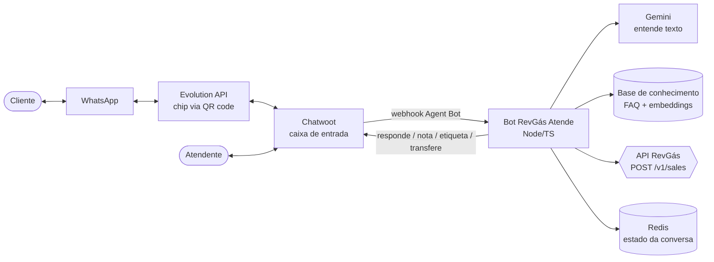

# RevGás Atende — Documento de Design

Projeto de Extensão VI · Transformação Digital · 2026.2
Data: 2026-11-18 · Status: **rascunho para aprovação**

---

## 1. Intenção (o porquê)

Revendas de gás (GLP) recebem a maior parte dos pedidos pelo WhatsApp e digitam tudo à mão no ERP RevGás. O projeto entrega um **atendente virtual no WhatsApp** que conduz o pedido do começo ao fim e **cria a venda no ERP pela API**, com uma **central de atendimento (Chatwoot)** onde uma pessoa assume a conversa sempre que preciso.

Entregas da disciplina:
1. **Produto funcionando** (demonstração ao vivo no WhatsApp).
2. **Relatório** com revisão bibliográfica e **validação científica** (métodos do material 02.2: quantitativo + qualitativo).

Diferencial em relação ao projeto de referência da turma (DEVsavin/ChatBot---RevGas, Python + WAHA, fila em arquivo HTML): código próprio em outra stack e **atendimento humano de verdade** num painel profissional, que é o próprio tipo de produto que a Flow (cliente do projeto) vende.

## 2. Objetivos, não-objetivos e anti-objetivos

**Objetivos**
- Coletar no WhatsApp: nome, produto, quantidade, telefone (vem do WhatsApp), endereço e forma de pagamento (com troco, se for dinheiro), um dado por vez, aceitando também texto livre ("manda 2 botijão pra Rua Nova 10, pago no pix").
- Mostrar um **resumo** e só criar a venda (`POST /v1/sales`) depois do "confirmo" explícito do cliente.
- **Transferir para um humano** no Chatwoot quando o cliente pedir, quando o bot não entender duas vezes seguidas ou em **emergência (cheiro de gás)**. A transferência leva uma nota com o resumo do que já foi coletado e uma etiqueta (`urgente`, `vazamento`, `pedido-incompleto`).
- Responder **dúvidas frequentes** (preço, horário, área de entrega, segurança) a partir de uma base de conhecimento (**RAG**).
- Gerar dados para o relatório: log estruturado de cada atendimento e um conjunto de testes de avaliação da IA.

**Não-objetivos (fora desta versão)**
- API oficial do WhatsApp (Cloud API/Meta). Usamos um chip comum via Evolution API.
- Cadastro e busca de clientes no ERP (a chave atual não tem acesso, ver §6).
- Cobrança/pagamento online, devolução, nota fiscal e rastreio do entregador.
- Hospedagem em nuvem: a demo roda num notebook com Docker.

**Anti-objetivos (fracasso mesmo que "funcione")**
- A IA **inventar preço**, produto ou forma de pagamento.
- Criar venda **sem confirmação** ou criar **venda duplicada**.
- Deixar o cliente em vazamento de gás sem as orientações de segurança imediatas.
- Vazar chave da API ou dados de clientes no repositório ou no log.

## 3. Abordagens consideradas

| | Abordagem | Prós | Contras |
|---|---|---|---|
| A | Python/FastAPI + Chatwoot (mesma base da referência) | Stack conhecida | Fica parecido demais com o projeto de referência |
| **B** | **Node/TypeScript + Evolution API + Chatwoot + IA (Gemini)** | Código próprio; WhatsApp↔Chatwoot pronto pela Evolution; testável | Chatwoot é pesado (~3 GB RAM), exige Docker Desktop |
| C | n8n + Chatwoot (low-code) | Rápido de montar | Difícil de testar e de validar no relatório |

**Escolhida: B** (decisão da equipe). Entre os conectores de WhatsApp, foi escolhida a **Evolution API** em vez do WAHA por ter integração nativa e gratuita com o Chatwoot e por diferenciar a arquitetura da referência.
IA: **Gemini na cota grátis** (decisão da equipe).

## 4. Arquitetura



Tudo sobe com um `docker compose up`: Postgres (com pgvector, exigido pelo Chatwoot), Redis, Chatwoot (web + sidekiq), Evolution API e o bot. Postgres e Redis são compartilhados entre Chatwoot e Evolution.

**Caminho de uma mensagem**
1. O cliente manda mensagem → a Evolution entrega à caixa "WhatsApp RevGás" do Chatwoot.
2. A caixa tem o **Agent Bot** "RevGás Atende" ligado: o Chatwoot chama o webhook do bot (`message_created`).
3. O bot ignora o que não é mensagem recebida do cliente (mensagens de saída, notas, conversas já com humano).
4. O bot carrega o estado da conversa (Redis), interpreta, decide e responde pela API do Chatwoot → Evolution → WhatsApp.
5. Na transferência, o bot muda a conversa de `pending` para `open`. Daí em diante o bot fica calado, e o atendente vê tudo no painel.

### Módulos do bot

| Módulo | Responsabilidade |
|---|---|
| `canal/chatwoot` | Recebe o webhook, filtra eventos, envia mensagens, notas, etiquetas e status pela API do Chatwoot |
| `conversa/` | **Máquina de estados determinística** do pedido (o "cérebro" de regras) |
| `ia/` | Gemini: classifica a **intenção** e extrai **entidades** em JSON validado (zod). Só interpreta, nunca decide |
| `conhecimento/` | RAG: FAQ em Markdown → embeddings (Gemini) em memória → busca + resposta fundamentada |
| `vendas/` | Catálogo, cálculo de total, montagem do corpo e porta `ApiRevGas` (falsa em memória e real HTTP) |
| `metricas/` | Log estruturado (JSONL) de eventos do atendimento, sem dados pessoais |

## 5. Fluxo da conversa

Estados: `INICIO → NOME → PRODUTO → QUANTIDADE → ENDERECO → PAGAMENTO → (TROCO) → RESUMO → REGISTRADO`, e `HUMANO` (saída a partir de qualquer estado).

- **Texto livre:** a cada mensagem a IA devolve `{intencao, entidades}`. As entidades válidas preenchem todos os campos de uma vez, e o bot pergunta só o que falta. "manda 2 botijão pra Rua Nova 10, Centro, pago no pix" pula direto para o que falta (nome, cidade).
- **Intenções:** `fazer_pedido`, `informar_dados`, `duvida` (vai ao RAG), `falar_com_humano`, `emergencia_gas`, `confirmar`, `corrigir`, `cancelar`, `saudacao`, `outro`.
- **Sem IA** (sem chave, timeout de 8 s, cota esgotada ou número fora da lista): o mesmo fluxo funciona por **menus numerados** ("1 - Botijão P13"). A IA melhora a experiência, mas não é ponto único de falha.
- **Resumo:** itens, quantidade × preço do catálogo, total, endereço e pagamento, com "1 - Confirmar · 2 - Corrigir · 3 - Cancelar". Corrigir volta só ao campo escolhido.
- **Emergência:** palavras-chave determinísticas ("cheiro de gás", "vazando", "vazamento") **e** a intenção da IA. Envia na hora as orientações de segurança, depois transfere com etiqueta `urgente` + `vazamento` e prioridade alta.
- **Duas falhas seguidas de entendimento** → transfere com etiqueta `pedido-incompleto` e nota com o que já foi coletado.

## 6. Integração com a API RevGás

Documentação: https://revgas.stoplight.io/docs/revgas-api. Endpoint usado: `POST https://api.revgas.com/v1/sales`, autenticação pelo cabeçalho `Authorization: <API_KEY>` (sem "Bearer").

Corpo enviado:
```json
{
  "customer_id": "<REVGAS_CLIENTE_DEMO>",
  "establishment_id": "<REVGAS_ESTABELECIMENTO>",
  "location": "Rua Nova", "number": "10", "neighborhood": "Centro",
  "city": "Teresina", "state_federation": "PI",
  "complement": "", "landmark": "",
  "observation": "Pedido via WhatsApp (RevGás Atende). Cliente: <nome> <telefone>. Troco para R$ 200,00.",
  "products": [{ "product_id": 26717, "quantity": 2, "value": 110.00 }],
  "payments": [{ "payment_type": "PIX", "value": 220.00 }],
  "channel": "WHATSAPP", "origin": "INTEGRATION", "option": "NORMAL", "broadcast": "NONE"
}
```

Regras:
- **Preço e `product_id` vêm só do catálogo** (`config/catalogo.json`), nunca da IA. Formas de pagamento aceitas: `PIX`, `MONEY`, `CARTAO_DE_DEBITO`, `CARTAO_DE_CREDITO`.
- **Cliente:** a chave não acessa `/customers`, então toda venda usa o cliente de demonstração (`REVGAS_CLIENTE_DEMO`) e o nome e telefone reais vão em `observation`.
- **`broadcast: NONE`**: a venda de teste não notifica entregadores.
- **Venda real só com `VENDA_REAL=true`.** O padrão é a API falsa em memória, que imita as respostas (201/422/429/5xx). Ao iniciar com venda real, o bot imprime um aviso bem visível.
- **Sem duplicidade:** cada conversa guarda o `id` da venda criada. Uma segunda confirmação não cria outra venda. Em **timeout do POST, nunca repete às cegas**: o bot transfere para humano com a etiqueta `verificar-venda`.
- **Limite de 1 req/s** respeitado por uma fila simples no adaptador HTTP.
- 422 (dados inválidos) → o bot pede ao cliente para corrigir o campo apontado, quando der para identificar; senão, transfere.

## 7. Segurança e privacidade

- Segredos (`REVGAS_API_KEY`, `GEMINI_API_KEY`, tokens do Chatwoot e da Evolution) só no `.env`, que fica no `.gitignore`. O repositório tem só o `.env.example`.
- **Gemini na cota grátis pode usar os dados para treino.** Por isso a IA só atende números da equipe (`NUMEROS_IA`). Os demais clientes usam o fluxo por menus. Para produção, o relatório recomenda plano pago.
- O webhook do bot só é acessível pela rede interna do Docker, com token secreto no caminho (`/webhook/<BOT_WEBHOOK_TOKEN>`). As portas expostas no host ficam em `127.0.0.1`.
- O log de métricas não grava texto de mensagens, nome, telefone nem endereço: só eventos, estados, tempos e IDs internos.
- **WhatsApp não oficial:** usar um chip separado, que pode ser bloqueado sem prejuízo.

## 8. Validação (para o relatório)

Conforme o material "Métodos e Validação Científica em Engenharia de Software":

**Quantitativo**
1. **Avaliação da IA (offline):** um conjunto rotulado de ~60 mensagens reais de pedido de gás (gírias, erros de digitação, áudio transcrito à mão, frases incompletas). Mede **acurácia de intenção** e **precisão/revocação por entidade** (produto, quantidade, endereço, pagamento). Roda com `npm run eval` e gera uma tabela em Markdown para o relatório.
2. **Simulação ponta a ponta:** cerca de 20 roteiros de conversa (felizes, com correção, com emergência, com IA desligada) executados contra o bot com a API falsa. Mede **taxa de conclusão**, **nº de mensagens até a venda** e **tempo até a venda**.
3. **Comparação com e sem IA** (o mesmo roteiro pelo menu × texto livre): nº de mensagens e tempo. É o "experimento" com hipótese: *H1: com interpretação por IA, o cliente conclui o pedido com menos mensagens*.
4. **Testes automatizados** (vitest) da máquina de estados, do cálculo de valores, do corpo da venda e dos filtros do webhook, com cobertura reportada.

**Qualitativo**
5. **Teste com usuários** (5–8 colegas ou familiares): cada um faz um pedido real pelo WhatsApp e depois responde o questionário **SUS** (System Usability Scale) mais 2–3 perguntas abertas. Os relatos entram em codificação temática no relatório.

## 9. Demonstração (roteiro)

1. Painel do Chatwoot aberto num lado da tela e WhatsApp do celular espelhado no outro.
2. **Pedido em texto livre:** "boa tarde, quero 2 botijão pra Rua Nova 10 Centro Teresina, pago no pix" → bot pede o nome → resumo → "1" → "Pedido registrado nº …". Mostrar a venda no ERP (com `VENDA_REAL=true`) ou o registro da API falsa.
3. **Pedido por menu** (outro número, sem IA).
4. **Dúvida (RAG):** "vocês entregam no domingo?"
5. **Emergência:** "tô sentindo cheiro de gás" → orientações imediatas → a conversa aparece no Chatwoot como **urgente**, e o atendente responde pelo painel e a resposta chega no WhatsApp.
6. Mostrar a tabela de resultados da avaliação.

## 10. Stack e estrutura

- **Node.js 22 + TypeScript**, servidor HTTP **Fastify**, validação **zod**, IA **@google/genai** (Gemini 2.5 Flash com saída estruturada; `gemini-embedding-001` para o RAG), **ioredis**, testes **vitest**.
- Infra: `docker-compose.yml` com `postgres` (pgvector), `redis`, `chatwoot` + `chatwoot-sidekiq`, `evolution-api` (v2) e `bot`. Um script `scripts/setup` cria o Agent Bot no Chatwoot e liga a Evolution à caixa de entrada.

```text
revgas-atende/
├── docker-compose.yml
├── .env.example
├── config/            catalogo.json, pagamentos.json, seguranca.md, faq/*.md
├── src/
│   ├── canal/         chatwoot (webhook + cliente da API)
│   ├── conversa/      máquina de estados e mensagens
│   ├── ia/            interpretador Gemini + interpretador falso
│   ├── conhecimento/  RAG
│   ├── vendas/        catálogo, pedido, ApiRevGas (falsa e http)
│   ├── metricas/
│   └── servidor.ts    monta as peças
├── eval/              mensagens rotuladas + roteiros de simulação
├── tests/
└── docs/              specs, relatório (rascunho), roteiro da demo
```

## 11. Decisões tomadas pelo autor do design (revisar)

- Venda sempre com o **cliente de demonstração** e os dados reais em `observation` (limitação da chave).
- **IDs:** estabelecimento **2580** e produto **26717 (botijão P13, R$ 110,00)**, herdados do projeto de referência. **Precisam ser confirmados com o professor ou a RevGás.**
- **IA só para números da equipe** (privacidade da cota grátis). O professor testa pelo fluxo de menus, ou o número dele é adicionado à lista na hora da demo.
- Estado da conversa no **Redis** com expiração de 2 h (sobrevive a reinício do bot).
- RAG com embeddings **em memória** (a base de FAQ é pequena; banco vetorial seria exagero).
- Chatwoot self-hosted no Docker (não o Chatwoot Cloud pago).

## 12. Deixado para quem implementar

- Texto exato das mensagens do bot (tom cordial e curto, em pt-BR).
- Conteúdo inicial da FAQ (horário, área de entrega, preços, segurança), com placeholders para a revenda validar.
- Versões exatas das imagens Docker (fixar as versões estáveis atuais).
